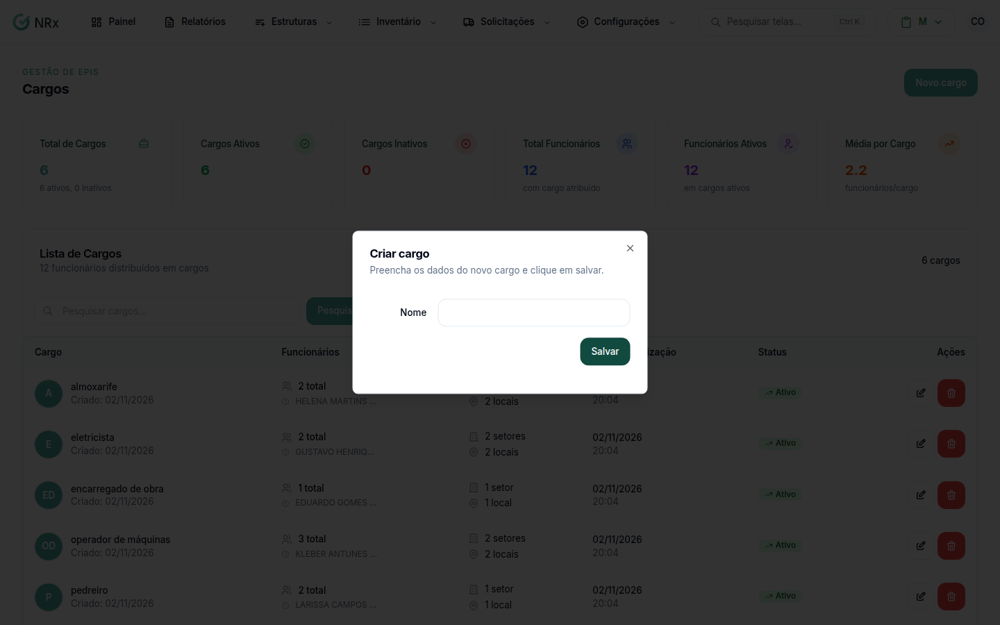

# Criar um cargo

**Para que serve:** cadastrar uma nova função da empresa.


**Quem pode fazer:** Administrador, com a permissão de criar cargos.


## Antes de começar

* Tenha o nome do cargo.

## Passo a passo



### Clique em Novo cargo

Clique em **Estruturas › Cargos** e depois em **Novo cargo**. Abre a janela **Criar cargo**.

<figure><figcaption>
Janela Criar cargo
</figcaption></figure>



### Preencha e salve

Digite o **Nome** (obrigatório, até 128 caracteres) e clique em **Salvar**. O cargo aparece na lista.



## Deu errado?

| Mensagem na tela | O que fazer |
| --- | --- |
| "Nome é obrigatório" | Preencha o nome. |
| "Nome muito longo" | Use até 128 caracteres. |

## Dúvidas comuns

Como ligo o cargo a um colaborador?

No cadastro do colaborador, dentro do setor. Veja [Vincular setor e cargo a um colaborador](../colaboradores/vincular-setores.md).

Vale para todos os módulos?

Sim. O cargo é o mesmo em todos os módulos do GNRx.

