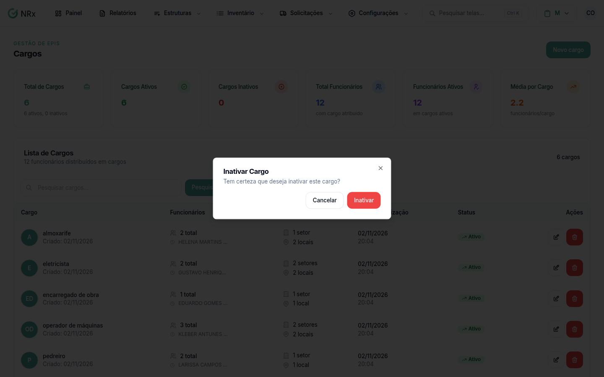

# Inativar um cargo

**Para que serve:** tirar da lista um cargo que a empresa não usa mais.


**Quem pode fazer:** Administrador, com a permissão de inativar cargos.


## Antes de começar

* Confira se o cargo é mesmo o certo. Use a [busca](listar-cargos.md).

## Passo a passo



### Clique na lixeira

Clique em **Estruturas › Cargos**. Na coluna **Ações**, clique no ícone de lixeira. Abre **Inativar Cargo**: "Tem certeza que deseja inativar este cargo?".

<figure><figcaption>
Inativar Cargo
</figcaption></figure>



### Confirme

Clique em **Inativar**. Aparece "Cargo excluído com sucesso!" e o cargo passa a aparecer como **Inativo**.



## Dúvidas comuns

A mensagem diz "excluído". O cargo foi apagado?

Não. O cargo fica inativo e continua na lista com o status **Inativo**.

Posso editar um cargo inativo?

Não. Os ícones de lápis e de lixeira ficam apagados.

