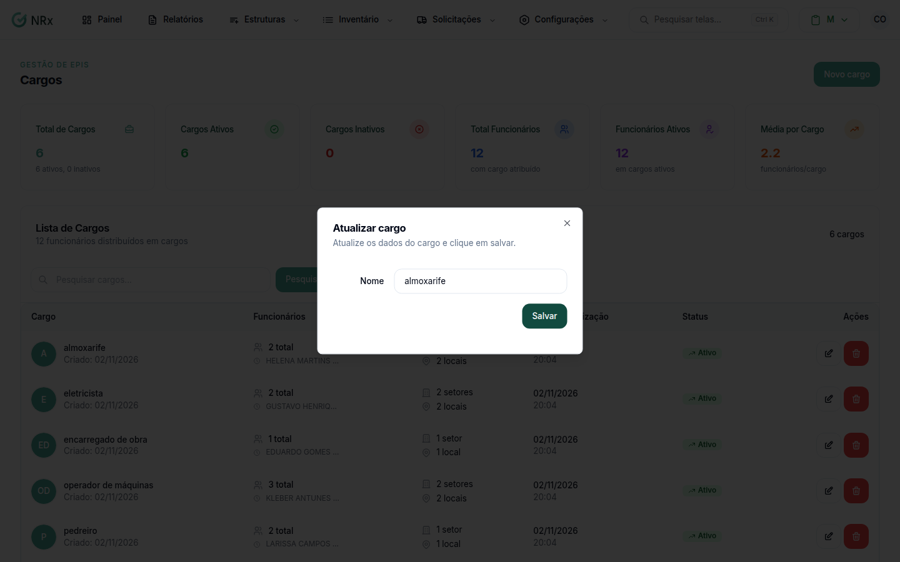

# Editar um cargo

**Para que serve:** corrigir o nome de um cargo.


**Quem pode fazer:** Gestor ou Administrador, com a permissão de editar cargos.


## Antes de começar

* O cargo precisa estar ativo.

## Passo a passo



### Abra a edição

Clique em **Estruturas › Cargos**. Na coluna **Ações**, clique no ícone de lápis. Abre a janela **Atualizar cargo**.

<figure><figcaption>
Janela Atualizar cargo
</figcaption></figure>



### Corrija e salve

Altere o **Nome** e clique em **Salvar**. Aparece "Atualizado com sucesso!".



## Dúvidas comuns

O ícone de lápis está apagado. Por quê?

O cargo está inativo. Cargos inativos não podem ser editados.

A mudança aparece para os colaboradores do cargo?

Sim. O cargo é um só para todos que estão nele.

