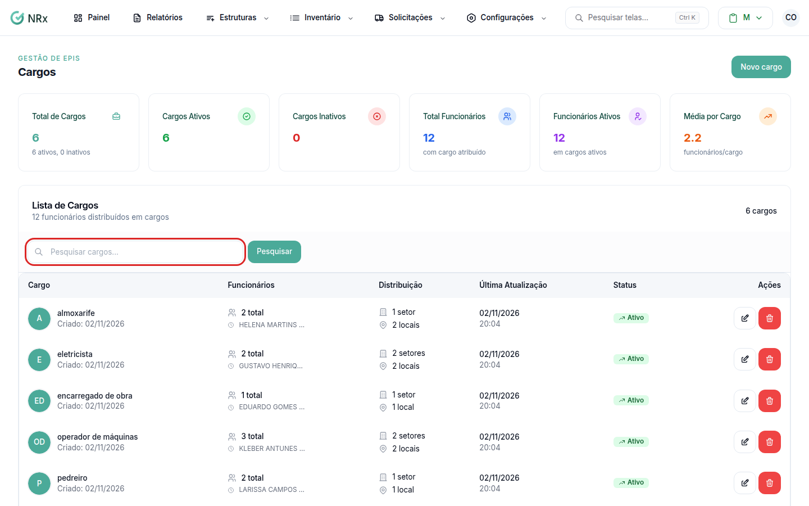

# Encontrar um cargo

**Para que serve:** achar um cargo e ver quantos colaboradores ele tem.


**Quem pode fazer:** Gestor ou Administrador, com a permissão de ver todos os cargos.


## Antes de começar

* Nada a preparar.

## Passo a passo



### Abra a lista

Clique em **Estruturas › Cargos**. Abre a **Lista de Cargos**, com as colunas **Cargo**, **Funcionários**, **Distribuição**, **Última Atualização**, **Status** e **Ações**.

<figure><figcaption>
Lista de Cargos
</figcaption></figure>



### Pesquise

Digite em **Pesquisar cargos...** e clique em **Pesquisar**. Clique em **Limpar** para voltar à lista completa.



## Deu errado?


**"Acesso Negado: Você não tem permissão para acessar esta página"**: só Gestor e Administrador abrem a lista de cargos.


## Dúvidas comuns

Apareceu "Nenhum cargo cadastrado".

A empresa ainda não tem cargos. Veja [Criar um cargo](criar-cargo.md).

Apareceu "Nenhum resultado encontrado".

Confira o termo pesquisado e clique em **Limpar** para tentar de novo.

