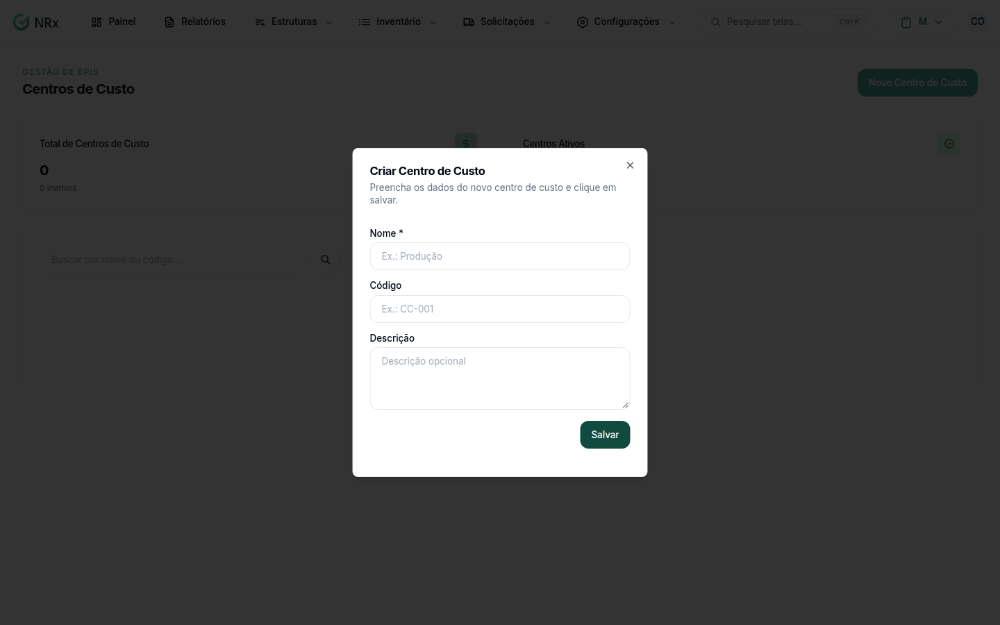

# Cadastrar um centro de custo

**Para que serve:** cadastrar os centros de custo, ligar às unidades e ver quanto cada um gasta com EPI.


**Quem pode fazer:** Gestor ou Administrador, com a permissão de criar centros de custo. Todas as roles podem ver.


## Antes de começar

* Tenha o nome e o código do centro de custo.

## Passo a passo



### Crie o centro de custo

Clique em **Estruturas › Centros de Custo** e depois em **Novo Centro de Custo**. Em **Criar Centro de Custo**, preencha o **Nome** (ex.: Produção), o **Código** (ex.: CC-001) e a **Descrição**. Salve.

<figure><figcaption>
Criar Centro de Custo
</figcaption></figure>



### Associe as unidades

Abra o centro de custo. Em **Unidades Associadas**, use **Associar Unidade**, escolha a unidade e clique em **Associar**. Aparece "Unidade associada com sucesso!".



### Veja a análise

Em **Análise Financeira**, veja o **Custo Total**, a **Curva de Custos**, os **Itens Mais Solicitados** e o custo **Por Unidade** e **Por Colaborador**.



## Deu errado?


**"Nome é obrigatório"**: preencha o nome.


## Dúvidas comuns

Como tiro um centro de custo?

Use **Inativar Centro de Custo** e confirme. Aparece "Centro de custo inativado com sucesso!".

Como corrijo os dados?

Use **Editar Centro de Custo** e salve.

