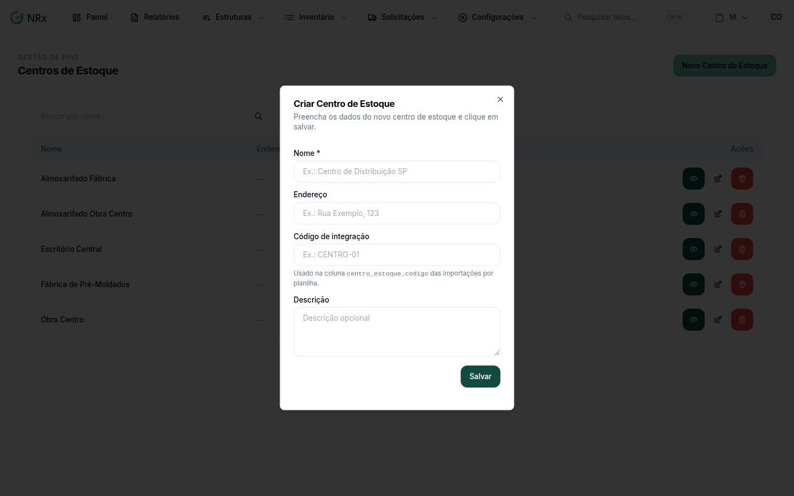

# Cadastrar um centro de estoque

**Para que serve:** cadastrar os lugares onde o estoque fica guardado (ex.: centro de distribuição) e ligar às unidades.


**Quem pode fazer:** Gestor ou Administrador, com a permissão de criar centros de estoque. Todas as roles podem ver.


## Antes de começar

* Se você usa integração, tenha o código usado na coluna `centro_estoque_codigo`.

## Passo a passo



### Crie o centro de estoque

Clique em **Estruturas › Centros de Estoque** e depois em **Novo Centro de Estoque**. Em **Criar Centro de Estoque**, preencha o **Nome** (ex.: Centro de Distribuição SP), o endereço, o **Código de integração** (ex.: CENTRO-01) e a descrição. Clique em **Salvar**.

<figure><figcaption>
Criar Centro de Estoque
</figcaption></figure>



### Associe as unidades

Abra o centro de estoque e associe as unidades atendidas por ele.



## Deu errado?

| Mensagem na tela | O que fazer |
| --- | --- |
| "Nome é obrigatório" | Preencha o nome. |
| "Código muito longo" | Encurte o código. |

## Dúvidas comuns

Como tiro um centro de estoque?

Use **Inativar Centro de Estoque** e confirme. Aparece "Centro de estoque inativado com sucesso!".

Como corrijo os dados?

Use **Editar Centro de Estoque** e salve.

