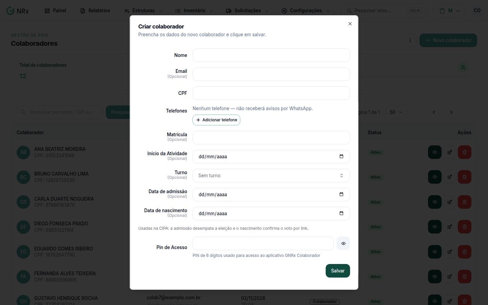

# Criar um colaborador

**Para que serve:** cadastrar uma pessoa que trabalha na empresa.


**Quem pode fazer:** Administrador, com a permissão de cadastrar colaboradores.


## Antes de começar

* Tenha o nome e o CPF da pessoa.
* Para um terceiro, cadastre antes a [empresa terceira](../terceiros/criar-terceiro.md) e crie o colaborador de dentro dela.

## Passo a passo



### Clique em Novo colaborador

Clique em **Estruturas › Colaboradores** e depois em **Novo colaborador**. Abre a janela **Criar colaborador** (ou **Criar colaborador terceiro**, se você estiver dentro de uma empresa terceira).

<figure><figcaption>
Janela Criar colaborador
</figcaption></figure>



### Preencha os dados

* **Nome:** obrigatório, até 128 caracteres.
* **CPF:** obrigatório.
* **Pin de Acesso:** é a senha de 6 números do colaborador no aplicativo e no Portal do Aluno.
* **Email**, telefone, **Matrícula** (até 20 caracteres), **Início da Atividade** e **Turno**: opcionais.

No **Turno**, escolha um turno ou digite um nome novo. O nome novo vira um [turno](../turnos/README.md).



### Salve

Clique em **Salvar**. Aparece "Colaborador criado com sucesso".



Depois, [vincule a unidade](vincular-unidades.md) e o [setor e o cargo](vincular-setores.md).

## Deu errado?

| Mensagem na tela | O que fazer |
| --- | --- |
| "Nome é obrigatório" | Preencha o nome. |
| "CPF inválido" | Confira o CPF (11 números). |
| "Senha deve ter 6 números" | O Pin de Acesso precisa ter 6 números. |
| "Email inválido" | Confira o e-mail. |
| "Data adesão inválida" | O início da atividade não pode ser no futuro. |
| "Limite Atingido" | O plano chegou ao limite de colaboradores ativos. Fale com o seu contato comercial da GNRx. |

## Dúvidas comuns

Posso criar sem e-mail?

Pode. O e-mail é opcional.

Vale para todos os módulos?

Sim. O colaborador é o mesmo em todos os módulos do GNRx.

