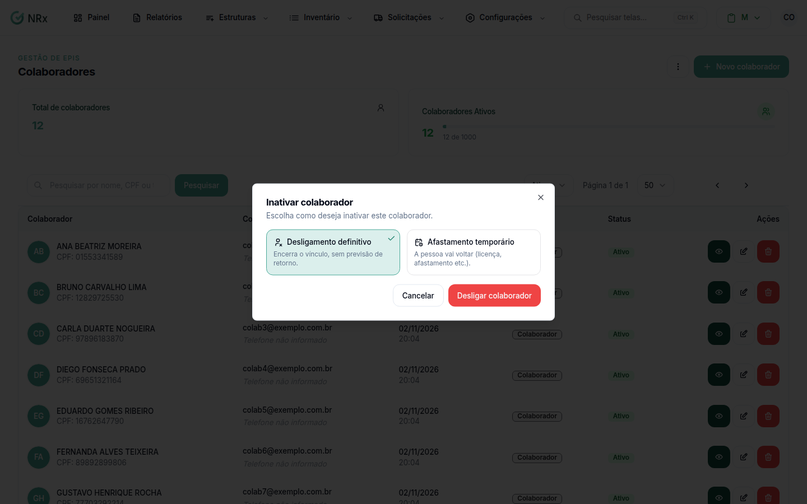
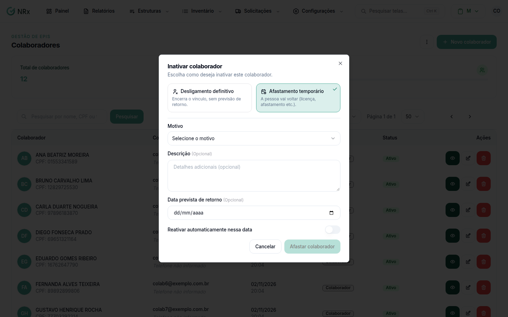

# Desligar, afastar ou reativar um colaborador

**Para que serve:** registrar que a pessoa saiu da empresa, que está afastada por um tempo, ou que voltou.


**Quem pode fazer:** Administrador, com a permissão de inativar colaboradores. Para reativar: Gestor ou Administrador, com a permissão de reativar colaboradores.


## Antes de começar

* Tenha o motivo do afastamento, se for o caso.

## Passo a passo



### Abra a inativação

Clique em **Estruturas › Colaboradores**. Na coluna **Ações**, abra o menu e clique em **Inativar**. Abre **Inativar colaborador**: "Escolha como deseja inativar este colaborador.".

<figure><figcaption>
Inativar colaborador
</figcaption></figure>



### Escolha o tipo

* **Desligamento definitivo:** encerra o vínculo, sem previsão de retorno.
* **Afastamento temporário:** a pessoa vai voltar. Escolha o **Motivo** (Alistamento militar, Licença maternidade, Licença paternidade, Licença médica, Licença sem vencimento ou Outro). Se quiser, informe a **Data prevista de retorno** e ligue **Reativar automaticamente nessa data**.

<figure><figcaption>
Afastamento temporário
</figcaption></figure>



### Confirme

Clique em **Desligar colaborador** ou **Afastar colaborador**. Aparece "Colaborador inativado com sucesso!".



### Para reativar

Filtre por **Inativos** ou **Afastados**. Na coluna **Ações**, abra o menu e clique em **Reativar**. Na janela **Reativar colaborador**, clique em **Reativar**. Aparece "Colaborador reativado com sucesso!".



## Deu errado?

O sistema pode mostrar avisos antes de confirmar:

| Mensagem na tela | O que fazer |
| --- | --- |
| "Este funcionário possui itens em aberto..." | Os itens continuam no histórico. Digite o nome do colaborador e clique em **Confirmar mesmo assim**. |
| "Este funcionário possui treinamentos em andamento..." | Os treinamentos continuam no histórico. Digite o nome e clique em **Confirmar mesmo assim**. |
| "Este funcionário tem estabilidade da CIPA..." | A dispensa sem justa causa é proibida. Escreva a **Justificativa do desligamento** e clique em **Justificar e desligar**, ou clique em **Manter colaborador**. |
| "Este funcionário tem estabilidade acidentária..." | Mesma coisa: justifique ou clique em **Manter colaborador**. |

## Dúvidas comuns

A pessoa volta sozinha do afastamento?

Só se você ligou **Reativar automaticamente nessa data**. Ela volta a ficar ativa no dia informado.

Perco o histórico ao inativar?

Não. O histórico continua guardado. O colaborador só deixa de entrar nos novos relatórios.

