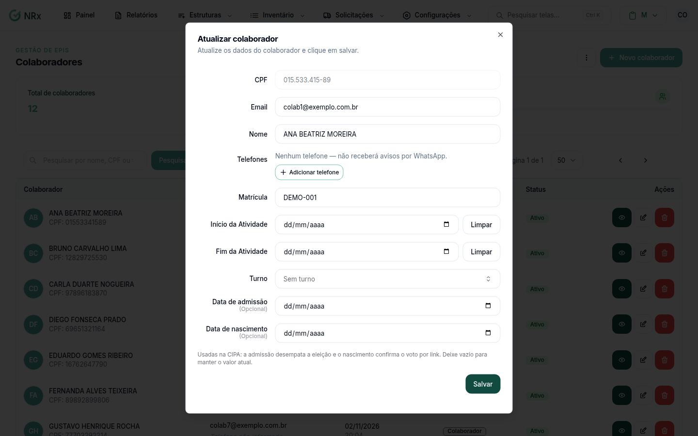

# Editar um colaborador

**Para que serve:** corrigir os dados de um colaborador, como e-mail, matrícula, datas e turno.


**Quem pode fazer:** Supervisor, Gestor ou Administrador, com a permissão de editar colaboradores.


## Antes de começar

* [Encontre o colaborador](listar-colaboradores.md).

## Passo a passo



### Abra a edição

Clique em **Estruturas › Colaboradores**. Na coluna **Ações**, abra o menu e clique em **Editar**. Abre **Atualizar colaborador**.

<figure><figcaption>
Janela Atualizar colaborador
</figcaption></figure>



### Corrija e salve

Altere o que precisar e salve. Aparece "Atualizado com sucesso!".



## Deu errado?

| Mensagem na tela | O que fazer |
| --- | --- |
| "A data de início não pode ser futura" | Use uma data de hoje ou anterior. |
| "O fim não pode ser antes do início" | Confira as datas de **Início da Atividade** e **Fim da Atividade**. |

## Dúvidas comuns

Como mudo o turno de várias pessoas de uma vez?

Se dois turnos são o mesmo, [una os turnos](../turnos/unir-turnos.md). Os colaboradores passam juntos.

Como mudo a unidade ou o setor?

No cadastro do colaborador. Veja [Vincular unidade](vincular-unidades.md) e [Vincular setor e cargo](vincular-setores.md).

