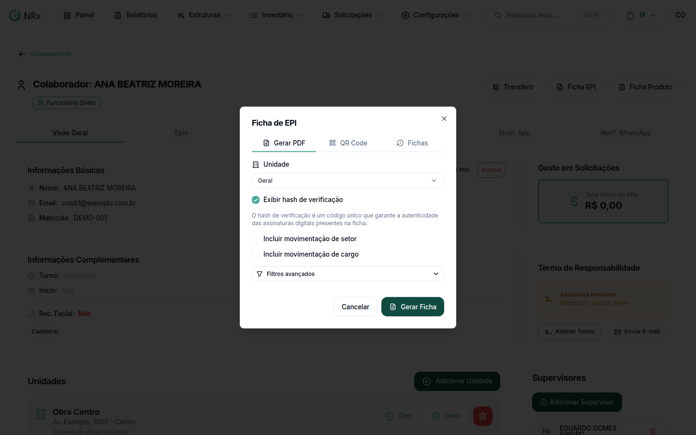

# Gerar a ficha de EPI

**Para que serve:** gerar a ficha de EPI do colaborador em PDF, ou um QR Code que abre a ficha.


**Quem pode fazer:** qualquer usuário com o módulo Gestão de EPIs.


## Antes de começar

* Abra o colaborador: **Estruturas › Colaboradores**, menu da coluna **Ações**, **Visualizar**.

## Passo a passo



### Abra a ficha

Clique em **Ficha EPI**.

<figure><figcaption>
Ficha de EPI
</figcaption></figure>



### Escolha a unidade e as opções

Em **Unidade**, escolha a unidade ou **Geral**. Unidade com "(customizado)" tem ficha própria. Se quiser, marque **Exibir hash de verificação**, **Incluir movimentação de setor** e **Incluir movimentação de cargo**, e limite o **Período de entrega** (**De** / **Até**).



### Gere o PDF

Clique em **Gerar PDF**. Aparece "Ficha de EPI gerada com sucesso" e o arquivo abre em uma nova aba.




**QR Code:** na aba **QR Code**, clique em **Gerar QR Code**. O QR Code é vitalício. Use **Baixar PNG** ou **Imprimir**. Quem escaneia vê a ficha.


## Dúvidas comuns

E os itens que não são EPI?

Clique em **Ficha Produto** e depois em **Gerar Ficha**. Aparece "Ficha de Produto gerada com sucesso".

Como mudo o logo e o CNPJ da ficha?

Na unidade. Veja [Configurar a unidade no EPI](../unidades/configuracoes-epi.md).

