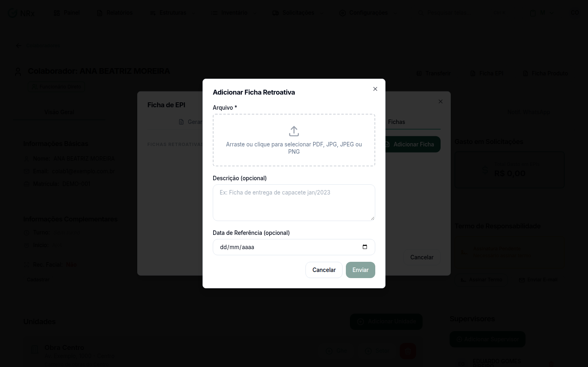

# Anexar uma ficha retroativa

**Para que serve:** guardar no cadastro do colaborador as fichas de EPI antigas, de antes do GNRx.


**Quem pode fazer:** Gestor ou Administrador, com a permissão de anexar fichas retroativas. Todas as roles podem ver as fichas.


## Antes de começar

* Tenha o arquivo da ficha (ex.: PDF escaneado).

## Passo a passo



### Abra o colaborador

Clique em **Estruturas › Colaboradores**. Na coluna **Ações**, abra o menu e clique em **Visualizar**. Vá ao cartão **Fichas Retroativas**.



### Anexe a ficha

Clique em **Adicionar Ficha**. Na janela **Adicionar Ficha Retroativa**, solte o **Arquivo** ou clique para escolher. Se quiser, preencha a **Descrição** (ex.: "Ficha de entrega de capacete jan/2023") e a **Data de Referência**. Envie. Aparece "Ficha enviada com sucesso!".

<figure><figcaption>
Adicionar Ficha Retroativa
</figcaption></figure>



## Dúvidas comuns

Como tiro uma ficha errada?

Clique em **Remover** na ficha e confirme em **Remover ficha**. Precisa da permissão de excluir fichas retroativas.

Quem vê as fichas retroativas?

Todas as roles podem ver as fichas anexadas.

