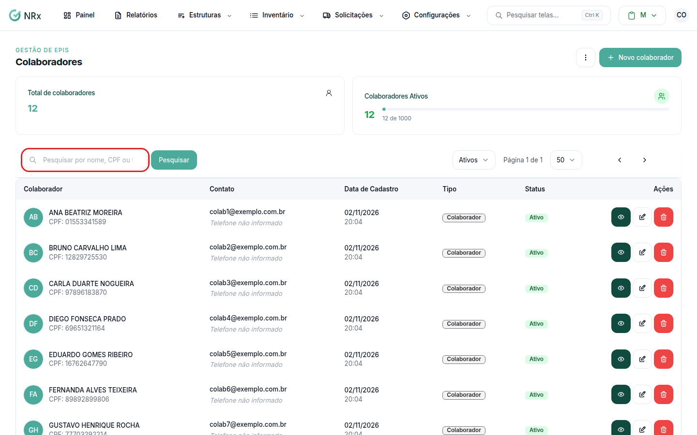

# Encontrar um colaborador

**Para que serve:** achar um colaborador e abrir o cadastro dele.


**Quem pode fazer:** todas as roles (Operador, Supervisor, Gestor e Administrador), com a permissão de ver colaboradores.


## Antes de começar

* Nada a preparar.

## Passo a passo



### Abra a lista

Clique em **Estruturas › Colaboradores**.

<figure><figcaption>
Lista de colaboradores
</figcaption></figure>



### Pesquise ou filtre

Digite em **Pesquisar por nome, CPF ou telefone...** e clique em **Pesquisar**. Use os filtros **Ativos**, **Inativos**, **Afastados** ou **Todos**.



### Abra o colaborador

Na coluna **Ações**, abra o menu e clique em **Visualizar**.



## Dúvidas comuns

O que significa o selo Terceiro?

O colaborador é de uma empresa terceira (em **Estruturas › Terceiros**, nos módulos que têm esse menu).

Qual a diferença entre Inativo e Afastado?

**Inativo** foi desligado. **Afastado** está fora por um tempo (licença, afastamento) e deve voltar. Veja [Desligar, afastar ou reativar](desativar-colaborador.md).

