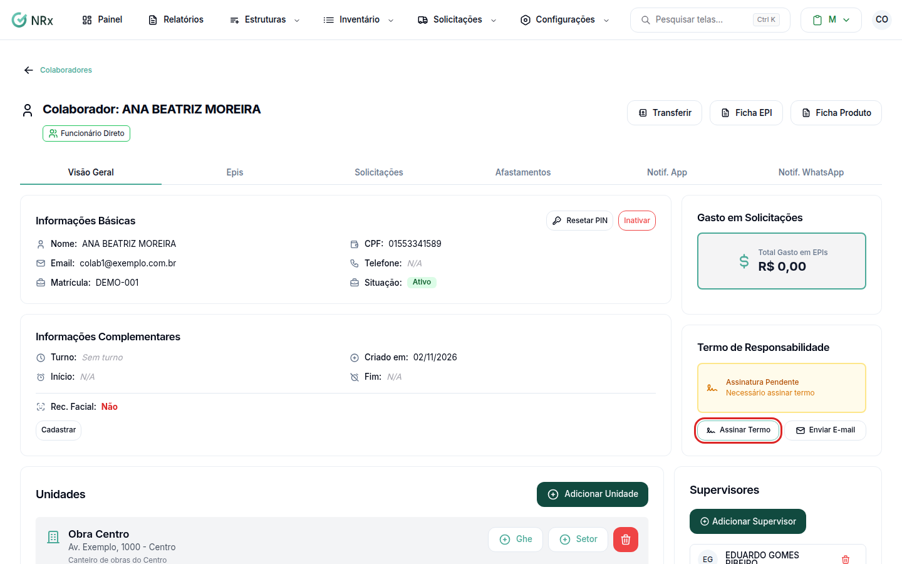
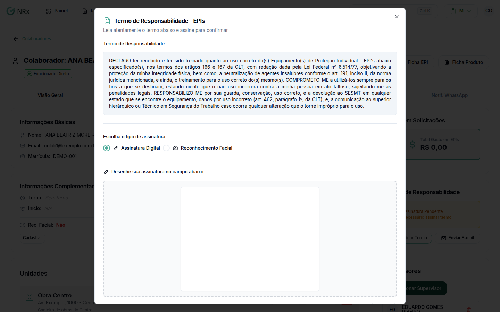

# Assinar o termo de responsabilidade

**Para que serve:** colher a assinatura do colaborador no termo de responsabilidade de EPI, na hora ou pelo celular dele.


**Quem pode fazer:** quem abre o cadastro do colaborador. Para enviar por e-mail: Gestor ou Administrador, com a permissão de enviar o termo de responsabilidade por e-mail.


## Antes de começar

* Abra o colaborador: **Estruturas › Colaboradores**, menu da coluna **Ações**, **Visualizar**.

## Passo a passo



### Veja a situação do termo

No cartão **Termo de Responsabilidade**, aparece **Assinado** (com a data em **Termo Assinado em**) ou **Assinatura Pendente** ("Necessário assinar termo").

<figure><figcaption>
Cartão Termo de Responsabilidade
</figcaption></figure>



### Colete na hora

Clique em **Assinar Termo**. Na janela **Termo de Responsabilidade - EPIs**, o colaborador lê o termo. Em **Escolha o tipo de assinatura:**, escolha:

* **Assinatura Digital:** ele desenha a assinatura no campo. **Limpar** apaga para recomeçar.
* **Reconhecimento Facial:** escolha a câmera, clique em **Iniciar Captura** e siga as orientações da tela. Ou clique em **Capturar Agora**.

<figure><figcaption>
Termo de Responsabilidade - EPIs
</figcaption></figure>



### Confirme

Clique em **Confirmar e Assinar**. Aparece "Termo assinado com sucesso".




**Pelo celular:** enquanto o termo está pendente, clique no ícone de envio por e-mail. Na janela **Enviar termo por e-mail**, confira o **E-mail do colaborador**, escolha a **Unidade** (ou **Geral (sem unidade)**) e clique em **Enviar agora**. O colaborador recebe um link para assinar.


## Deu errado?

| Mensagem na tela | O que fazer |
| --- | --- |
| "Por favor, complete a assinatura antes de continuar" | O colaborador precisa assinar antes de confirmar. |
| "Erro ao acessar câmera" | Libere o acesso à câmera no navegador. |
| "Aproxime-se da câmera" ou "Afaste-se um pouco da câmera" | Ajuste a distância e segure a posição. |

## Dúvidas comuns

Como confiro uma assinatura?

Com o termo assinado, clique em **Verificar Assinatura**.

Preciso colher de novo. Como faço?

Clique em **Refazer Assinatura**. Abre **Refazer Assinatura de Termo**: "Colete uma nova assinatura para substituir a anterior". O botão só aparece para quem tem permissão.

