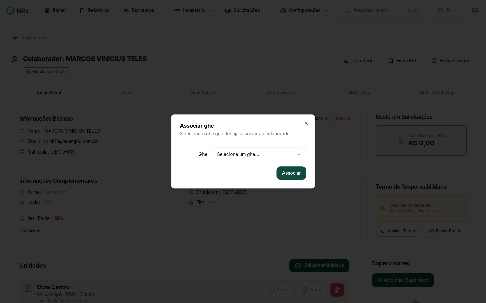

# Vincular um GHE a um colaborador

**Para que serve:** colocar o colaborador num GHE pela tela dele, no módulo Gestão de EPIs.


**Quem pode fazer:** Supervisor, Gestor ou Administrador, com a permissão de editar colaboradores.


## Antes de começar

* [Vincule a unidade](vincular-unidades.md) ao colaborador.
* O [GHE](../ghes/criar-ghe.md) precisa existir nessa unidade.

## Passo a passo



### Abra o colaborador

Clique em **Estruturas › Colaboradores**. Na coluna **Ações**, abra o menu e clique em **Visualizar**.



### Associe o GHE

Na unidade, clique em **Ghe**. Na janela **Associar ghe**, escolha o GHE ("Selecione um ghe...") e clique em **Associar**. Aparece "Ghe associado com sucesso".

<figure><figcaption>
Associar ghe
</figcaption></figure>




**Para remover:** clique no ícone de lixeira do GHE e confirme em **Remover Grupo**. Aparece "Grupo removido com sucesso".


## Dúvidas comuns

Apareceu "Nenhum ghe disponível...".

A unidade não tem GHE ativo. [Crie um GHE](../ghes/criar-ghe.md) nela.

Dá para adicionar várias pessoas de uma vez?

Dá, pela tela do GHE. Veja [Adicionar colaboradores a um GHE](../ghes/colaboradores-do-ghe.md).

