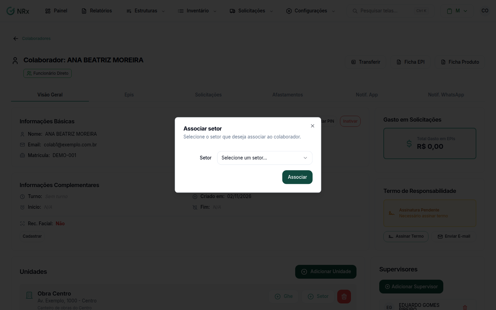

# Vincular setor e cargo a um colaborador

**Para que serve:** dizer em que setor e em que cargo o colaborador trabalha, dentro de cada unidade.


**Quem pode fazer:** Supervisor, Gestor ou Administrador, com a permissão de editar colaboradores.


## Antes de começar

* [Vincule a unidade](vincular-unidades.md) ao colaborador.
* O [setor](../setores/criar-setor.md) e o [cargo](../cargos/criar-cargo.md) precisam existir.

## Passo a passo



### Abra o colaborador

Clique em **Estruturas › Colaboradores**. Na coluna **Ações**, abra o menu e clique em **Visualizar**.



### Adicione o setor

Na unidade, clique em **Setor**. Na janela **Associar setor**, escolha o setor e clique em **Associar**. Aparece "Setor associado com sucesso".

<figure><figcaption>
Associar setor
</figcaption></figure>



### Adicione o cargo

No setor, clique em **Cargo**. Na janela **Associar cargo**, escolha o cargo e clique em **Associar**. Aparece "Cargo associado com sucesso".




**Para remover:** clique no ícone de lixeira do setor ou do cargo e confirme em **Remover Setor** ou no aviso do cargo. Aparece "Setor removido com sucesso" ou "Cargo removido com sucesso".


## Dúvidas comuns

O cargo fica dentro do setor?

Sim. Primeiro adicione o setor; depois, no setor, o cargo.

A pessoa pode ter mais de um setor?

Pode. Adicione quantos setores precisar em cada unidade.

