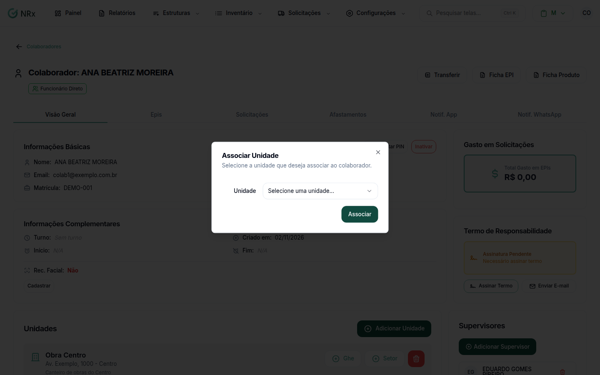

# Vincular uma unidade a um colaborador

**Para que serve:** dizer em quais unidades o colaborador trabalha.


**Quem pode fazer:** Supervisor, Gestor ou Administrador, com a permissão de editar colaboradores.


## Antes de começar

* A [unidade](../unidades/criar-unidade.md) precisa existir.
* O colaborador precisa estar ativo.

## Passo a passo



### Abra o colaborador

Clique em **Estruturas › Colaboradores**. Na coluna **Ações**, abra o menu e clique em **Visualizar**.



### Adicione a unidade

No quadro **Unidades**, clique em **Adicionar Unidade**. Na janela **Associar Unidade**, escolha a **Unidade** e confirme.

<figure><figcaption>
Associar Unidade
</figcaption></figure>




**Para remover:** clique no ícone de lixeira da unidade e confirme em **Remover unidade**. Aparece "Unidade removida com sucesso".


## Deu errado?


**"É obrigatório"**: escolha uma unidade antes de confirmar.


## Dúvidas comuns

O botão Adicionar Unidade está apagado.

O colaborador está inativo. Reative antes.

E o setor?

O setor fica dentro da unidade. Veja [Vincular setor e cargo](vincular-setores.md).

