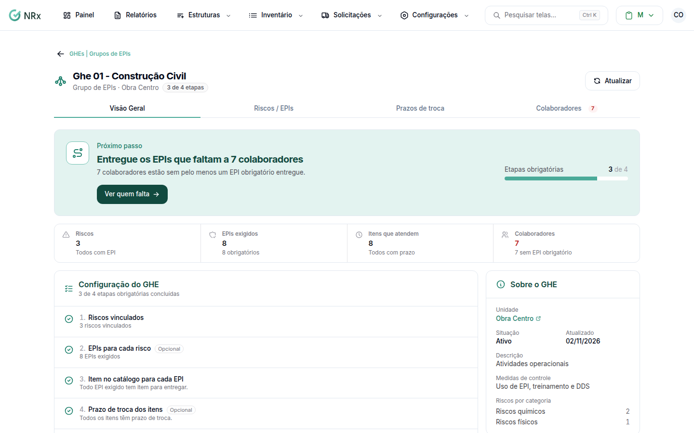

# GHE — Grupos de EPIs

**Para que serve:** juntar os colaboradores expostos aos mesmos riscos, para o GNRx saber quais EPIs cada um precisa receber e quando trocar.


No módulo Gestão de EPIs, clique em **Estruturas › GHEs — Grupos de EPIs**.


Dentro do GHE, a aba **Visão Geral** mostra a **Configuração do GHE** como uma lista de etapas: riscos vinculados, EPIs para cada risco, item no catálogo para cada EPI, prazo de troca dos itens e colaboradores no GHE. Quando tudo está pronto, aparece **GHE pronto**.

<figure><figcaption>
Configuração do GHE
</figcaption></figure>

## Comece por aqui

<table data-view="cards"><thead><tr><th></th><th></th><th data-hidden data-card-target data-type="content-ref"></th></tr></thead><tbody><tr><td><strong>Criar um GHE</strong></td><td>Cadastre o grupo numa unidade.</td><td><a href="criar-ghe.md">criar-ghe.md</a></td></tr><tr><td><strong>Vincular riscos</strong></td><td>Diga a que riscos o grupo está exposto.</td><td><a href="vincular-riscos.md">vincular-riscos.md</a></td></tr><tr><td><strong>Escolher os EPIs</strong></td><td>Diga quais EPIs cada risco exige.</td><td><a href="vincular-epis.md">vincular-epis.md</a></td></tr></tbody></table>

## Tarefas do dia a dia

<table data-view="cards"><thead><tr><th></th><th></th><th data-hidden data-card-target data-type="content-ref"></th></tr></thead><tbody><tr><td><strong>Adicionar colaboradores</strong></td><td>Coloque as pessoas no grupo.</td><td></td></tr><tr><td><strong>Definir prazos de troca</strong></td><td>Diga a cada quantos dias trocar cada item.</td><td><a href="prazos-de-troca.md">prazos-de-troca.md</a></td></tr><tr><td><strong>Copiar de outro GHE</strong></td><td>Reaproveite a configuração de um grupo parecido.</td><td><a href="copiar-configuracoes.md">copiar-configuracoes.md</a></td></tr><tr><td><strong>Encontrar um GHE</strong></td><td>Pesquise e filtre a lista.</td><td><a href="listar-ghe.md">listar-ghe.md</a></td></tr><tr><td><strong>Editar um GHE</strong></td><td>Corrija nome, unidade ou descrição.</td><td><a href="editar-ghe.md">editar-ghe.md</a></td></tr><tr><td><strong>Inativar ou reativar</strong></td><td>Tire da lista um grupo sem uso.</td><td><a href="desativar-ghe.md">desativar-ghe.md</a></td></tr></tbody></table>
