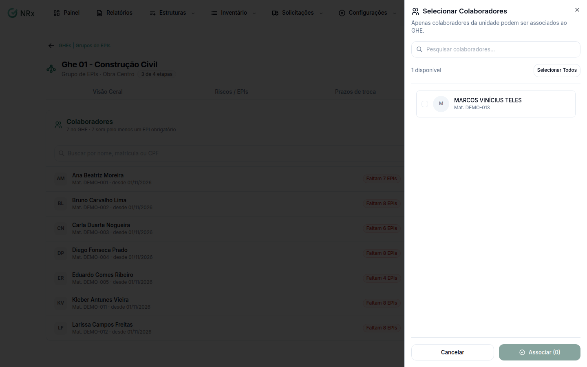

# Adicionar colaboradores a um GHE

**Para que serve:** colocar as pessoas no grupo. Quem está no GHE recebe os EPIs exigidos pelos riscos dele.


**Quem pode fazer:** Gestor ou Administrador, com a permissão de associar EPIs aos GHEs.


## Antes de começar

* Os colaboradores precisam estar na unidade do GHE.

## Passo a passo



### Abra os colaboradores

No GHE, abra a aba **Colaboradores** e clique em **Adicionar Colaboradores**. Abre **Selecionar Colaboradores**.

<figure><figcaption>
Selecionar Colaboradores
</figcaption></figure>



### Marque e associe

Use **Pesquisar colaboradores...**, marque as pessoas (ou **Selecionar Todos**) e clique em **Associar**. Aparece "N colaboradores associados ao GHE.".




**Para tirar alguém:** na aba **Colaboradores**, marque quem sai do GHE e clique em **Remover**. Confirme em **Remover do GHE?**. A pessoa deixa de receber os EPIs exigidos pelo GHE. As entregas já feitas continuam na ficha.


## Deu errado?


**"Associação parcial"**: parte dos colaboradores não foi associada. Confira se eles estão na unidade do GHE.


## Dúvidas comuns

Apareceu "Todos os colaboradores já estão no GHE".

Não há mais ninguém para adicionar.

Como vejo quem está sem EPI obrigatório?

Na aba **Colaboradores**, quem está sem EPI aparece com o aviso (ex.: "Falta 1 EPI"). Se aparecer "Ninguém sem EPI obrigatório. Tudo em dia.", está tudo certo.

