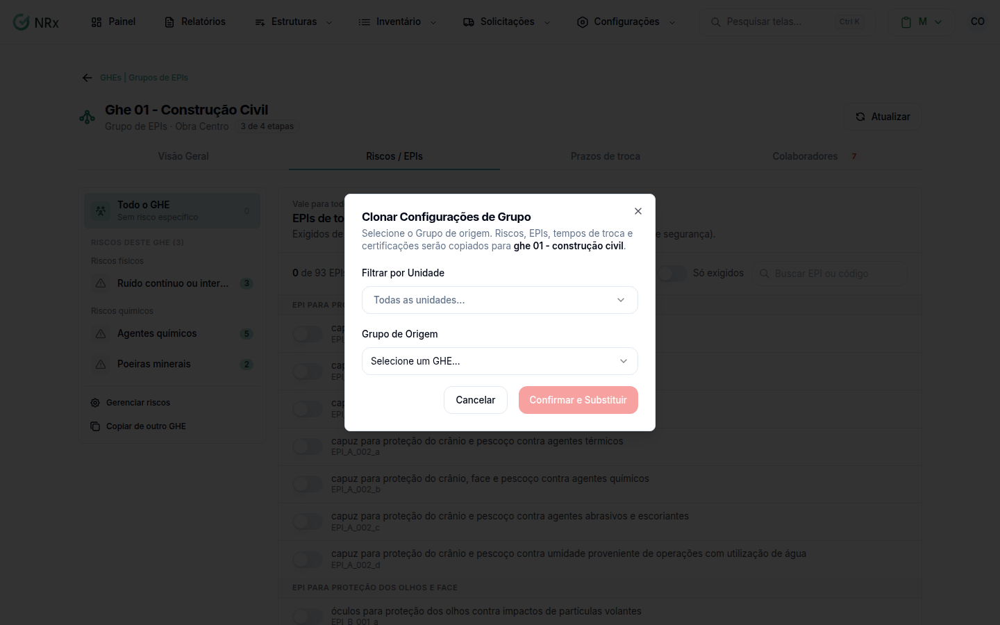

# Copiar a configuração de outro GHE

**Para que serve:** reaproveitar riscos, EPIs, tempos de troca e certificações de um GHE parecido.


**Quem pode fazer:** Gestor ou Administrador, com a permissão de associar EPIs aos GHEs.


## Antes de começar

* Tenha um GHE já configurado para usar como origem.


As configurações atuais do GHE são **substituídas** pelas do GHE de origem. Não dá para desfazer.


## Passo a passo



### Abra a cópia

No GHE, clique em **Copiar de outro GHE**. Abre **Clonar Configurações de Grupo**.

<figure><figcaption>
Clonar Configurações de Grupo
</figcaption></figure>



### Escolha a origem

Se quiser, use **Filtrar por Unidade**. Em **Grupo de Origem**, escolha o GHE. Leia o aviso.



### Confirme

Clique em **Clonar Configurações**. Aparece "Configurações copiadas".



## Dúvidas comuns

Os colaboradores também são copiados?

Não. São copiados riscos, EPIs, tempos de troca e certificações.

Posso copiar ao criar o GHE?

Pode. Use **Copiar configurações de outro grupo** na janela **Criar Novo Grupo**.

