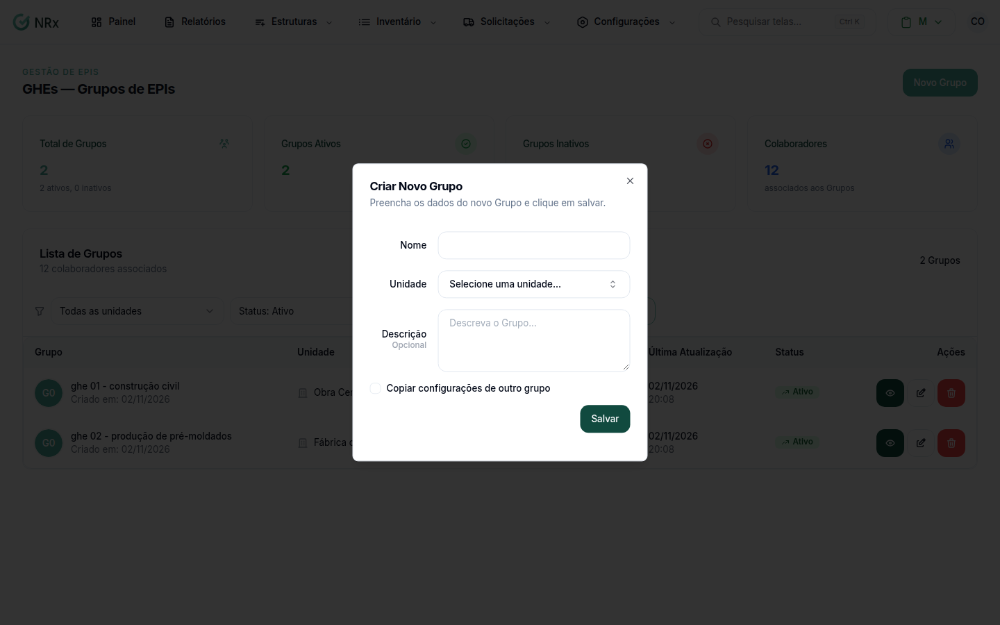

# Criar um GHE

**Para que serve:** cadastrar um grupo de colaboradores expostos aos mesmos riscos, dentro de uma unidade.


**Quem pode fazer:** Gestor ou Administrador, com a permissão de cadastrar GHEs.


## Antes de começar

* Cadastre a [unidade](../unidades/criar-unidade.md).

## Passo a passo



### Clique em Novo Grupo

Clique em **Estruturas**, abra os GHEs (no módulo Gestão de EPIs, **Estruturas › GHEs — Grupos de EPIs**) e clique em **Novo Grupo**. Abre **Criar Novo Grupo**.

<figure><figcaption>
Janela Criar Novo Grupo
</figcaption></figure>



### Preencha os dados

Preencha o **Nome** e escolha a **Unidade**. Se quiser, preencha a descrição ("Descreva o Grupo...") e as medidas de controle.



### Copie de outro grupo (opcional)

Para aproveitar a configuração de um GHE parecido, use **Copiar configurações de outro grupo**. Se quiser, filtre por unidade e escolha o grupo.



### Salve

Clique em **Salvar**. Aparece "Grupo criado com sucesso" (ou "Grupo criado com sucesso e configurações copiadas").



No módulo Gestão de EPIs, o próximo passo é vincular os riscos, na aba **Riscos / EPIs** do GHE.

## Deu errado?

| Mensagem na tela | O que fazer |
| --- | --- |
| "Obrigatório" | Preencha o nome e escolha a unidade. |
| "Nome muito longo", "Descrição muito longa" ou "Medidas de controle muito longo" | Encurte o texto. |

## Dúvidas comuns

Um GHE vale para várias unidades?

Não. Cada GHE fica numa unidade. Para outra unidade, crie outro GHE e copie a configuração.

Preciso copiar de outro grupo?

Não. A cópia é opcional. Sem ela, você configura o GHE do zero.

