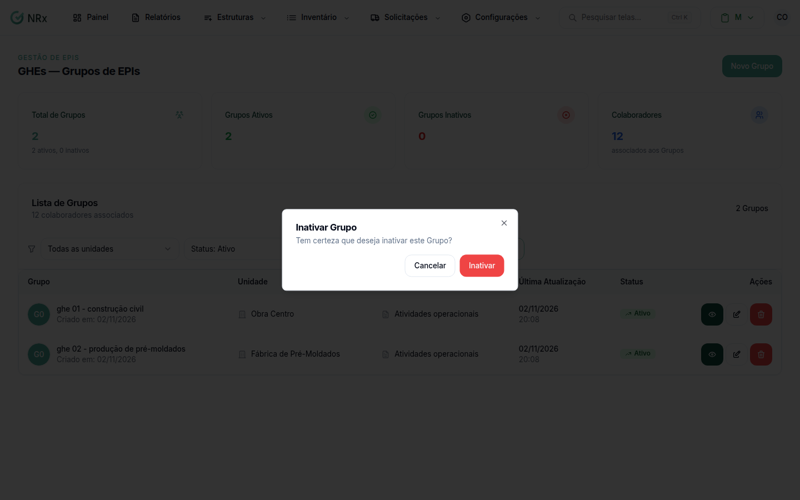

# Inativar ou reativar um GHE

**Para que serve:** tirar da lista um GHE que a empresa não usa mais, ou trazer de volta.


**Quem pode fazer:** Gestor ou Administrador, com a permissão de inativar GHEs.


## Antes de começar

* Confira se o GHE é mesmo o certo. Use a [busca](listar-ghe.md).

## Passo a passo



### Inative

Clique em **Estruturas** e abra os GHEs (no módulo Gestão de EPIs, **Estruturas › GHEs — Grupos de EPIs**). Na coluna **Ações**, clique no ícone de lixeira. Abre **Inativar Grupo**: "Tem certeza que deseja inativar este Grupo?". Clique em **Inativar**. Aparece "Grupo excluído com sucesso!".

<figure><figcaption>
Inativar Grupo
</figcaption></figure>



### Para reativar

Em **Filtrar por status**, escolha **Status: Inativo**. Na coluna **Ações**, use **Reativar grupo** e confirme. Aparece "Grupo reativado com sucesso!".



## Dúvidas comuns

A mensagem diz "excluído". O GHE foi apagado?

Não. O GHE fica inativo e pode ser reativado.

Inativei uma unidade e os GHEs dela ficaram inativos.

É assim mesmo: ao inativar uma unidade, os GHEs dela são inativados junto.

