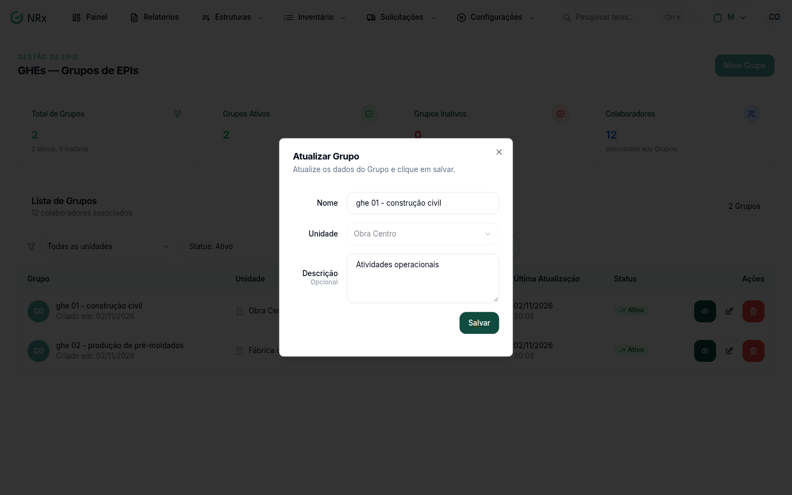

# Editar um GHE

**Para que serve:** corrigir o nome, a unidade, a descrição ou as medidas de controle de um GHE.


**Quem pode fazer:** Gestor ou Administrador, com a permissão de editar GHEs.


## Antes de começar

* [Encontre o GHE](listar-ghe.md).

## Passo a passo



### Abra a edição

Na lista, clique no ícone de lápis do GHE. Ou, dentro do GHE, clique em **Atualizar**. Abre **Atualizar Grupo**.

<figure><figcaption>
Janela Atualizar Grupo
</figcaption></figure>



### Corrija e salve

Altere o que precisar e salve. Aparece "Grupo atualizado com sucesso!".



## Deu errado?

| Mensagem na tela | O que fazer |
| --- | --- |
| "Nome é obrigatório" | Preencha o nome. |
| "Unidade é obrigatório" | Escolha a unidade. |

## Dúvidas comuns

Como mudo os riscos ou os EPIs?

No módulo Gestão de EPIs, na aba **Riscos / EPIs** do GHE.

Como mudo os prazos de troca?

No módulo Gestão de EPIs, na aba **Prazos de troca** do GHE.

