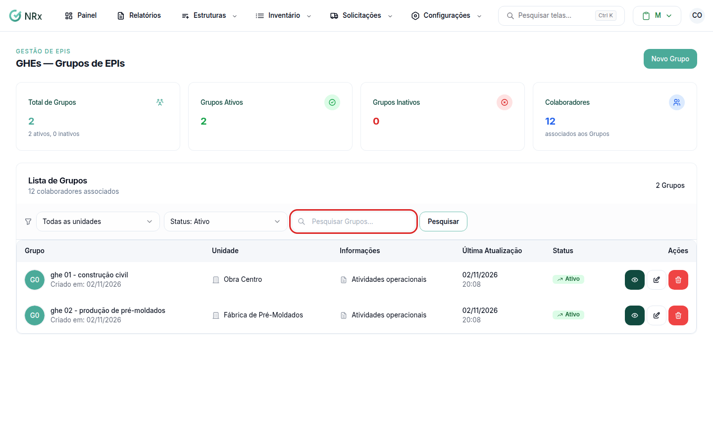

# Encontrar um GHE

**Para que serve:** achar um GHE e abrir a configuração dele.


**Quem pode fazer:** Gestor ou Administrador, com a permissão de ver GHEs.


## Antes de começar

* Nada a preparar.

## Passo a passo



### Abra a lista

Clique em **Estruturas › GHEs — Grupos de EPIs**. Abre a **Lista de Grupos**.

<figure><figcaption>
Lista de Grupos
</figcaption></figure>



### Pesquise ou filtre

Digite em **Pesquisar Grupos...** e clique em **Pesquisar**. Use **Filtrar por unidade** e **Filtrar por status** (**Status: Todos**, **Status: Ativo** ou **Status: Inativo**).



### Abra o GHE

Na coluna **Ações**, clique no ícone de olho. O GHE abre com as abas **Visão Geral**, **Riscos / EPIs**, **Prazos de troca** e **Colaboradores**.



## Dúvidas comuns

Apareceu "Nenhum Grupo cadastrado".

A empresa ainda não tem GHEs. Veja [Criar um GHE](criar-ghe.md).

O que é o selo Configuração completa?

O GHE já tem riscos, EPIs, itens, prazos e colaboradores configurados.

