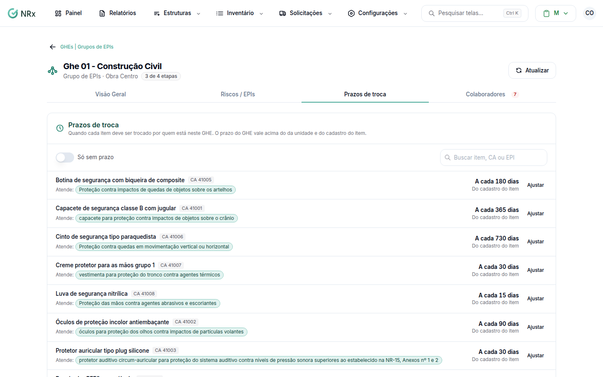

# Definir prazos de troca

**Para que serve:** dizer quando cada item deve ser trocado por quem está no GHE. Com prazo, o sistema avisa quando trocar.


**Quem pode fazer:** Gestor ou Administrador, com a permissão de associar EPIs aos GHEs.


## Antes de começar

* [Escolha os EPIs](vincular-epis.md). Os itens aparecem aqui quando atendem algum EPI exigido pelo GHE.

## Passo a passo



### Abra os prazos

No GHE, abra a aba **Prazos de troca**. Cada item mostra de onde vem o prazo: **Definido neste GHE**, **Da unidade**, **Do cadastro do item** ou **Nem na unidade nem no item**.

<figure><figcaption>
Prazos de troca
</figcaption></figure>



### Defina o prazo

No item, escolha **Neste GHE** e informe **a cada** quantos **dias** (de 1 a 3650). Ou marque **Isento de troca**. Clique em **Salvar**. Aparece "Prazo de troca salvo para este GHE.".



### Volte ao prazo padrão (se quiser)

Escolha **Usar o da unidade**. O item volta a seguir o prazo da unidade ou do cadastro.




O prazo do GHE vale acima do da unidade e do cadastro do item.


## Dúvidas comuns

Como acho os itens sem prazo?

Use **Só sem prazo**. Se aparecer "Nenhum item sem prazo. Tudo certo por aqui.", todos têm prazo.

Apareceu "Informe de 1 a 3650 dias.".

O prazo precisa ficar entre 1 e 3650 dias.

