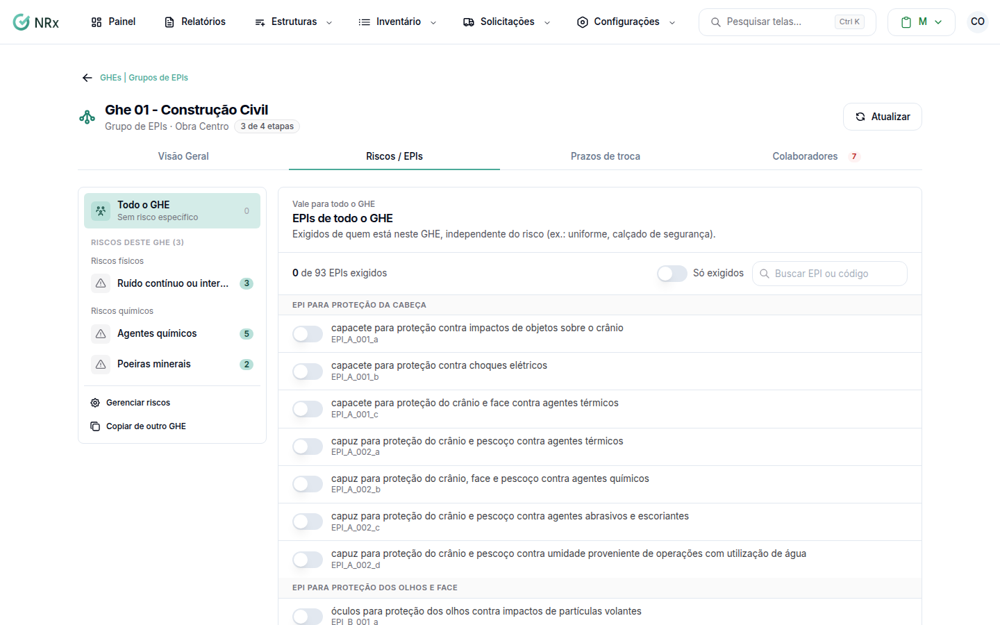

# Escolher os EPIs de um GHE

**Para que serve:** dizer quais EPIs quem está no GHE precisa receber, para cada risco ou para todo o grupo.


**Quem pode fazer:** Gestor ou Administrador, com a permissão de associar EPIs aos GHEs.


## Antes de começar

* [Vincule os riscos](vincular-riscos.md) ao GHE.

## Passo a passo



### Abra o risco

No GHE, abra a aba **Riscos / EPIs** e clique no risco. Para EPIs que valem para todos (ex.: uniforme, calçado de segurança), use **EPIs de todo o GHE**.

<figure><figcaption>
Riscos / EPIs
</figcaption></figure>



### Marque os EPIs

Use **Buscar EPI ou código** para achar o EPI e marque os que o risco exige. **Só exigidos** mostra só os marcados.



### Salve

Clique em **Salvar**. Aparece "EPIs do risco salvos.". Para desfazer antes de salvar, clique em **Descartar**.



## Dúvidas comuns

Apareceu "Nenhum item cadastrado atende este EPI".

Não há item no catálogo para esse EPI. Sem item cadastrado, não há o que entregar. Cadastre o item no catálogo.

O GHE não precisa de EPI. Tem problema?

Não. Se os riscos são controlados de outra forma, está tudo certo.

