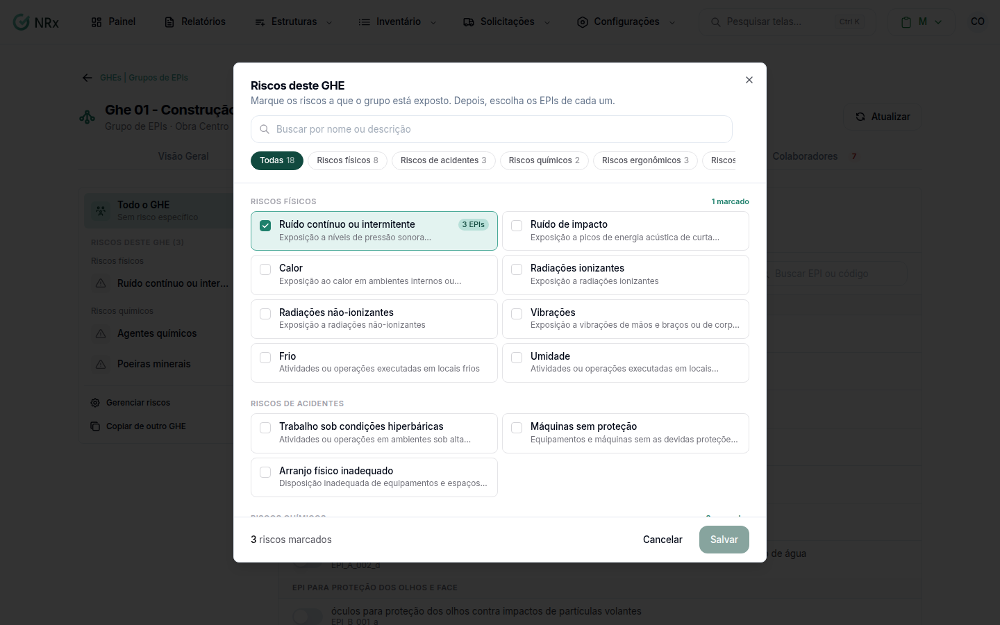

# Vincular riscos a um GHE

**Para que serve:** dizer a que riscos o grupo está exposto. Os riscos dizem quais EPIs o grupo precisa.


**Quem pode fazer:** Gestor ou Administrador, com a permissão de associar EPIs aos GHEs.


## Antes de começar

* [Crie o GHE](criar-ghe.md).

## Passo a passo



### Abra os riscos

No GHE, abra a aba **Riscos / EPIs** e clique em **Gerenciar riscos**. Abre **Riscos deste GHE**: "Marque os riscos a que o grupo está exposto.".

<figure><figcaption>
Riscos deste GHE
</figcaption></figure>



### Marque e salve

Use **Buscar por nome ou descrição** para achar o risco. Marque os riscos e clique em **Salvar**. Aparece "Riscos do GHE atualizados.".



Depois, [escolha os EPIs de cada risco](vincular-epis.md).

## Dúvidas comuns

O risco não aparece na lista.

Ele precisa estar cadastrado em **Configurações › Riscos**.

Dá para copiar os riscos de outro GHE?

Dá. Veja [Copiar a configuração de outro GHE](copiar-configuracoes.md).

