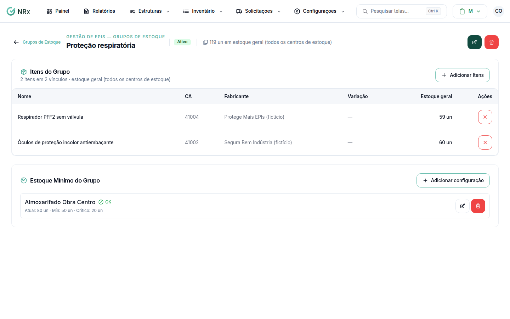

# Criar um grupo de estoque

**Para que serve:** juntar itens ou CAs equivalentes (ex.: Máscara PFF2 de várias marcas) para somar o estoque e definir o estoque mínimo do grupo.


**Quem pode fazer:** Gestor ou Administrador, com a permissão de cadastrar grupos de estoque. Todas as roles podem ver.


## Antes de começar

* Os itens precisam estar no catálogo, com a mesma unidade de medida.

## Passo a passo



### Crie o grupo

Clique em **Estruturas › Grupos de Estoque** e depois em **Novo Grupo**. Em **Criar Grupo de Estoque**, dê um nome (ex.: Máscara PFF2) e, se quiser, a descrição. Salve. Aparece "Grupo de estoque criado com sucesso".

<figure><figcaption>
Grupo de estoque
</figcaption></figure>



### Adicione os itens

Abra o grupo e adicione os itens. Use **Buscar itens por nome ou CA...**.



### Configure o estoque mínimo

Use **Configurar Estoque Mínimo**. Escolha o centro de estoque e informe o mínimo e o crítico. Salve. Aparece "Configuração criada com sucesso!".



## Deu errado?

| Mensagem na tela | O que fazer |
| --- | --- |
| "Todos os itens do catálogo já pertencem a este grupo ou usam uma unidade de medida diferente da já usada nele." | Use itens com a mesma unidade de medida. |
| "A crítica deve ser menor que a mínima" | Ajuste os valores. |
| "Adicione itens ao grupo antes de configurar o estoque mínimo" | Adicione os itens primeiro. |

## Dúvidas comuns

Como tiro um item do grupo?

Use **Remover do grupo**. Aparece "Item removido do grupo com sucesso".

Inativei o grupo. E os itens?

Os itens continuam existindo normalmente, só deixam de pertencer ao grupo.

