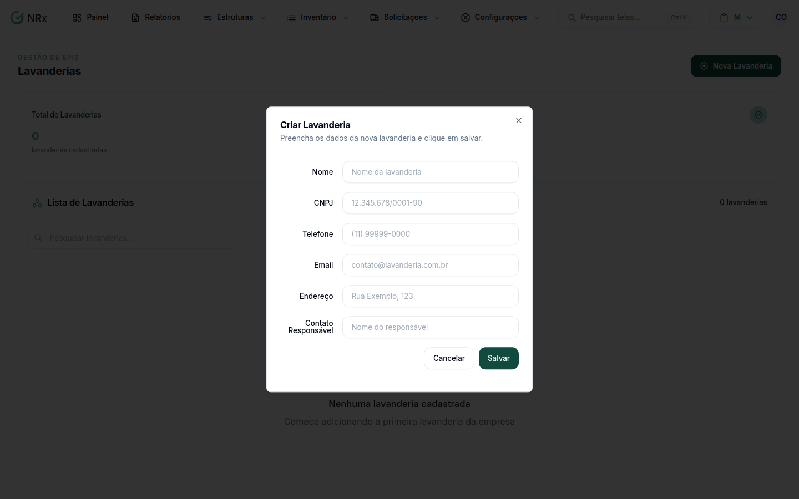

# Cadastrar uma lavanderia

**Para que serve:** cadastrar as lavanderias que higienizam os EPIs e acompanhar os itens que estão com elas.


**Quem pode fazer:** Gestor ou Administrador, com a permissão de cadastrar lavanderias. Todas as roles podem ver.


## Antes de começar

* Tenha o nome, o CNPJ e o contato da lavanderia.

## Passo a passo



### Clique em Nova Lavanderia

Clique em **Estruturas › Lavanderias** e depois em **Nova Lavanderia**. Abre **Criar Lavanderia**.

<figure><figcaption>
Criar Lavanderia
</figcaption></figure>



### Preencha e salve

Preencha o **Nome**, o **CNPJ**, o **Telefone**, o **Email**, o **Endereço** e o **Contato Responsável**. Clique em **Salvar**. Aparece "Lavanderia criada com sucesso".



### Acompanhe os itens

Abra a lavanderia. Veja **Itens na lavanderia**, **Itens atrasados**, **Tempo médio de permanência** e **Custo total no período**. Na lista **Itens**, filtre por **Em aberto**, **Retornados**, **Atrasados** ou **No prazo**.



## Deu errado?

| Mensagem na tela | O que fazer |
| --- | --- |
| "CNPJ inválido" | Confira o CNPJ. |
| "Email inválido" | Confira o e-mail. |

## Dúvidas comuns

Como tiro uma lavanderia?

Use **Inativar Lavanderia**. Os itens que já estão associados a ela continuam existindo.

Como corrijo os dados?

Use **Atualizar Lavanderia** e salve. Aparece "Lavanderia atualizada com sucesso".

