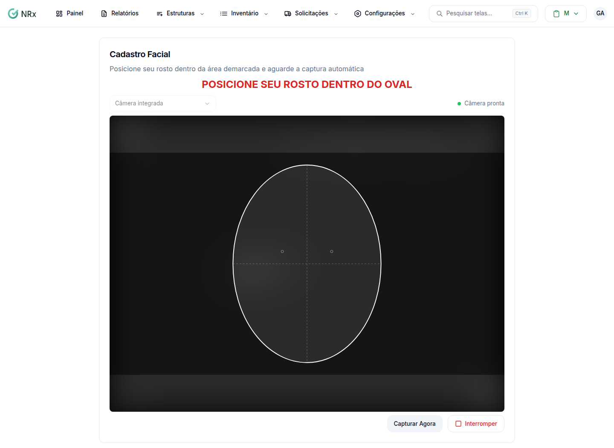

# Cadastrar o rosto do colaborador

**Para que serve:** ativar e capturar o rosto do colaborador para ele assinar com reconhecimento facial.


**Quem pode fazer:** Gestor ou Administrador, com a permissão de gerenciar reconhecimento facial.


## Antes de começar

* Use um computador com câmera e libere o acesso à câmera no navegador.
* Abra o colaborador: **Estruturas › Colaboradores**, menu da coluna **Ações**, **Visualizar**.

## Passo a passo



### Ative (se pedir)

Se aparecer **Ativar reconhecimento facial**, clique nele. Em **Confirmar Ativação**, clique em **Ativar**. Aparece "Ativação realizada com sucesso!".



### Abra o cadastro

Na linha **Rec. Facial**, clique em **Cadastrar** (ou **Editar**, para trocar). Abre **Cadastro Facial**.

<figure><figcaption>
Cadastro Facial
</figcaption></figure>



### Capture o rosto

Escolha a câmera e clique em **Iniciar Captura**. Siga as orientações: "Posicione seu rosto dentro do oval", "Aproxime-se da câmera", "Afaste-se um pouco da câmera", "Segure a posição". Ou clique em **Capturar Agora**.



### Finalize

Clique em **Finalizar Cadastro**. Aparece "Reconhecimento facial atualizado com sucesso!".



## Deu errado?

| Mensagem na tela | O que fazer |
| --- | --- |
| "Não foi possível acessar as câmeras." | Libere a câmera no navegador e confira se ela está conectada. |
| "Câmera desconectada" | Reconecte a câmera e escolha de novo. |

## Dúvidas comuns

Como tiro o reconhecimento facial?

Na linha **Rec. Facial**, clique em **Remover** e confirme em **Remover Reconhecimento Facial**.

O que acontece ao remover?

O sistema avisa: "Após esta alteração, o colaborador não poderá mais solicitar EPIs.".

