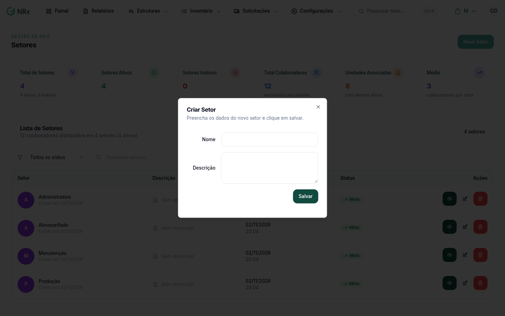

# Criar um setor

**Para que serve:** cadastrar uma nova área de trabalho.


**Quem pode fazer:** Administrador, com a permissão de criar setores.


## Antes de começar

* Tenha o nome do setor.

## Passo a passo



### Clique em Novo Setor

Clique em **Estruturas › Setores** e depois em **Novo Setor**. Abre a janela **Criar Setor**.

<figure><figcaption>
Janela Criar Setor
</figcaption></figure>



### Preencha e salve

* **Nome:** obrigatório, até 128 caracteres.
* **Descrição:** opcional, até 255 caracteres.

Clique em **Salvar**. O setor aparece na lista.



## Deu errado?

| Mensagem na tela | O que fazer |
| --- | --- |
| "Nome é obrigatório" | Preencha o nome. |
| "Nome muito longo" ou "Descrição muito longa" | Encurte o texto. |

## Dúvidas comuns

Como coloco o setor numa unidade?

Depois de criar, associe o setor à unidade. No módulo Gestão de EPIs, isso é feito na aba **Setores** da unidade.

Vale para todos os módulos?

Sim. O setor é o mesmo em todos os módulos do GNRx.

