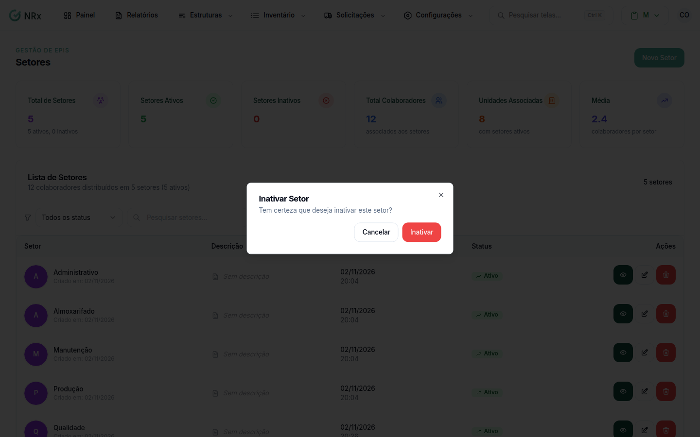

# Inativar um setor

**Para que serve:** tirar da lista um setor que a empresa não usa mais.


**Quem pode fazer:** Administrador, com a permissão de inativar setores.


## Antes de começar

* Confira se o setor é mesmo o certo. Use a [busca](listar-setores.md).

## Passo a passo



### Clique na lixeira

Clique em **Estruturas › Setores**. Na coluna **Ações**, clique no ícone de lixeira. Abre **Inativar Setor**: "Tem certeza que deseja inativar este setor?".

<figure><figcaption>
Inativar Setor
</figcaption></figure>



### Confirme

Clique em **Inativar**. Aparece "Setor excluído com sucesso!" e o setor passa a aparecer como **Inativo**.



## Dúvidas comuns

A mensagem diz "excluído". O setor foi apagado?

Não. O setor fica inativo e continua na lista com o status **Inativo**.

Posso editar um setor inativo?

Não. Os ícones de lápis e de lixeira ficam apagados.

