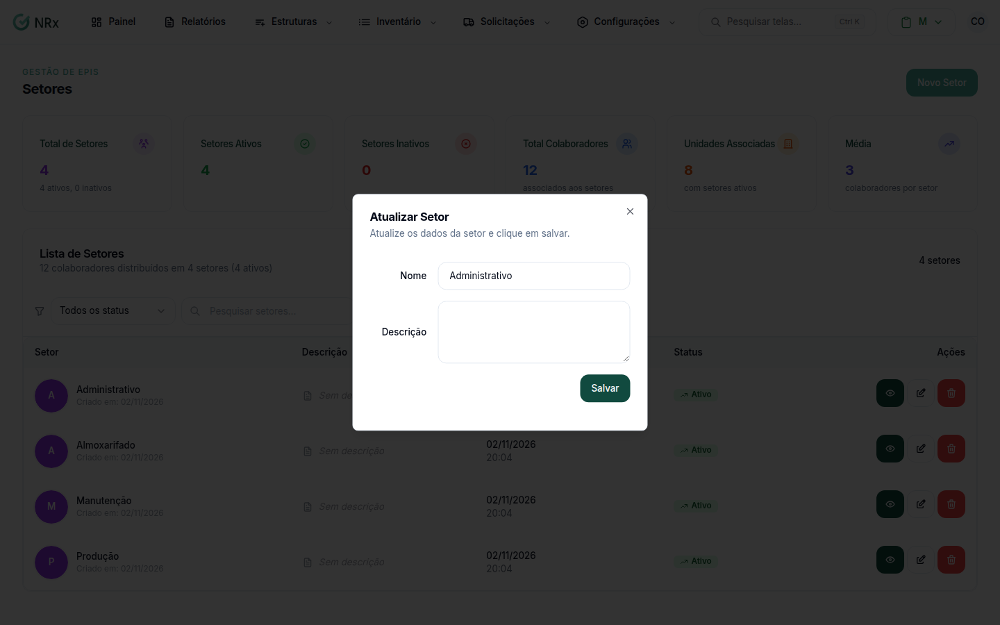

# Editar um setor

**Para que serve:** corrigir o nome ou a descrição de um setor.


**Quem pode fazer:** Gestor ou Administrador, com a permissão de editar setores.


## Antes de começar

* O setor precisa estar ativo.

## Passo a passo



### Abra a edição

Clique em **Estruturas › Setores**. Na coluna **Ações**, clique no ícone de lápis. Abre a janela **Atualizar Setor**.

<figure><figcaption>
Janela Atualizar Setor
</figcaption></figure>



### Corrija e salve

Altere o que precisar e clique em **Salvar**. Aparece "Atualizado com sucesso!".



## Dúvidas comuns

A mudança vale nas outras unidades?

Sim. O setor é um só, mesmo que esteja em várias unidades.

Os limites de texto são os mesmos da criação?

Sim: nome até 128 caracteres e descrição até 255.

