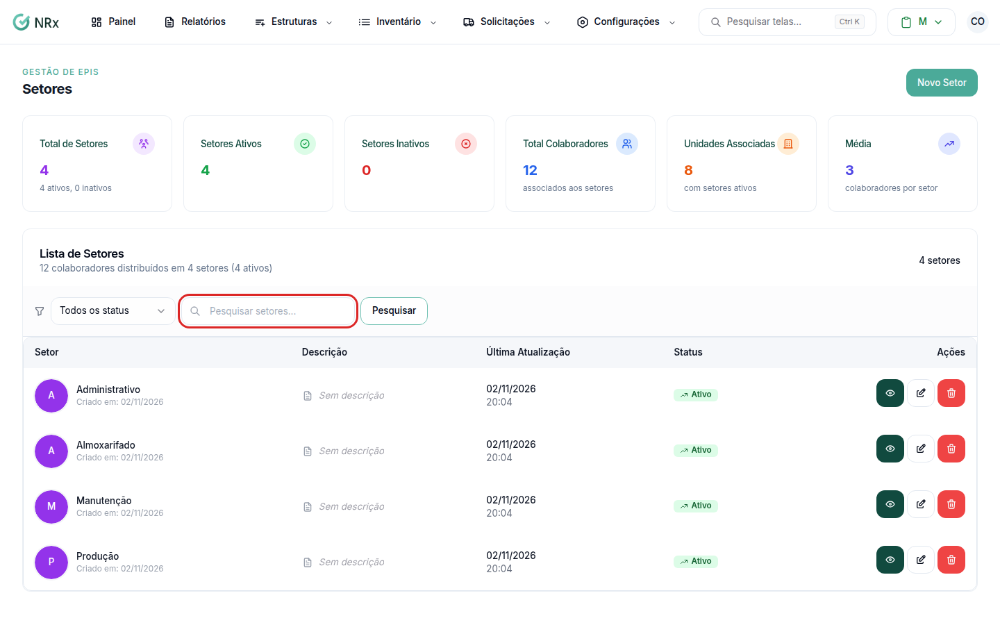

# Encontrar um setor

**Para que serve:** achar um setor na lista e ver em quais unidades ele está.


**Quem pode fazer:** todas as roles (Operador, Supervisor, Gestor e Administrador), com a permissão de ver setores.


## Antes de começar

* Nada a preparar.

## Passo a passo



### Abra a lista

Clique em **Estruturas › Setores**. Abre a **Lista de Setores**.

<figure><figcaption>
Lista de Setores
</figcaption></figure>



### Pesquise ou filtre

Digite em **Pesquisar setores...** e clique em **Pesquisar**. Use **Filtrar por status** para ver ativos ou inativos. Clique em **Limpar** para voltar.



### Abra o setor

Na coluna **Ações**, clique no ícone de olho. A aba **Unidades** mostra as unidades que possuem o setor.



## Dúvidas comuns

Apareceu "Nenhum setor cadastrado".

A empresa ainda não tem setores. Veja [Criar um setor](criar-setor.md).

Como acho os setores inativos?

Em **Filtrar por status**, escolha **Inativo**.

