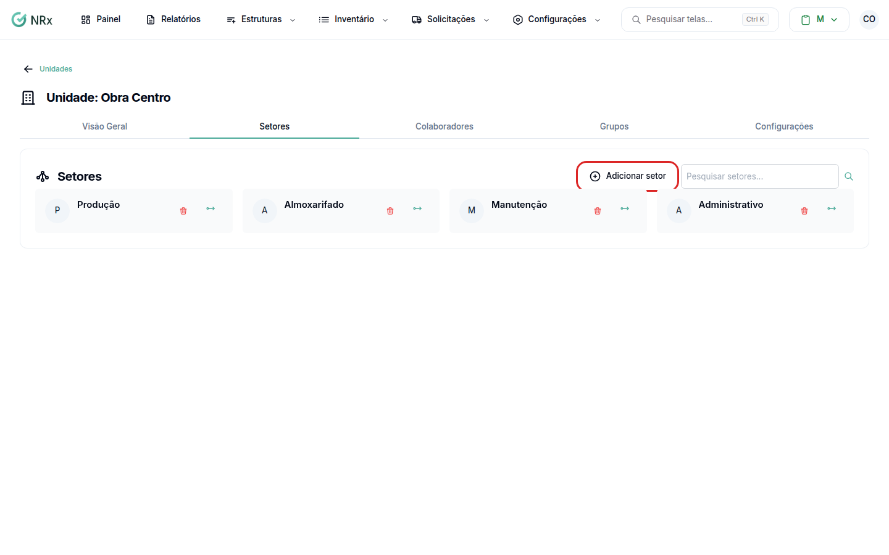
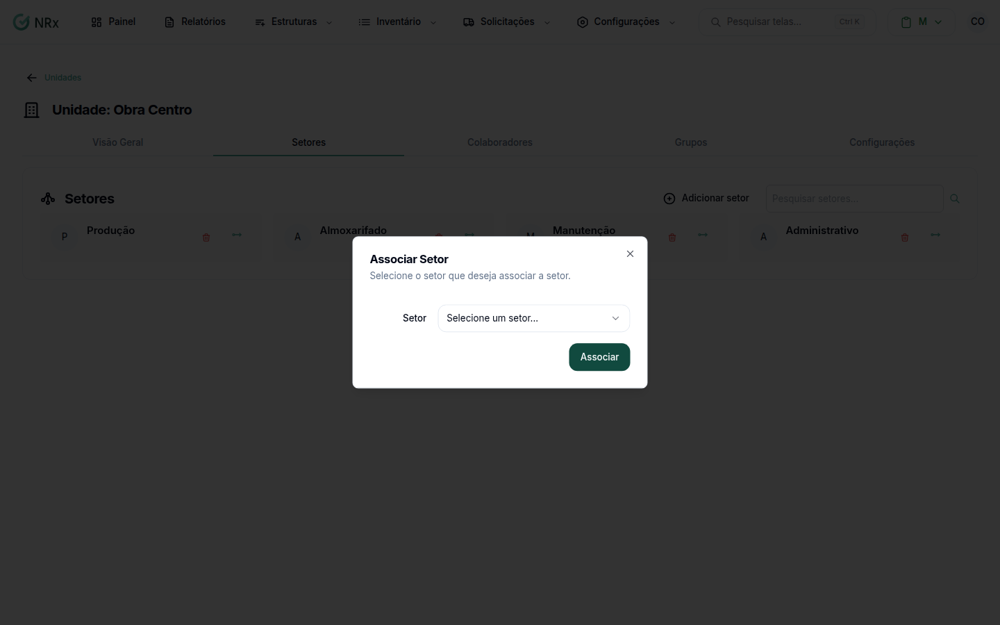

# Associar um setor a uma unidade

**Para que serve:** colocar um setor dentro de uma unidade, no módulo Gestão de EPIs.


**Quem pode fazer:** Gestor ou Administrador, com a permissão de editar unidades.


## Antes de começar

* [Crie o setor](criar-setor.md) e a [unidade](../unidades/criar-unidade.md).

## Passo a passo



### Abra a unidade

Clique em **Estruturas › Unidades**. Na coluna **Ações**, clique no ícone de olho. Abra a aba **Setores**.

<figure><figcaption>
Aba Setores da unidade
</figcaption></figure>



### Associe o setor

Clique em **Adicionar setor**. Na janela **Associar Setor**, escolha o **Setor** e confirme. Aparece "Setor associado com sucesso".

<figure><figcaption>
Janela Associar Setor
</figcaption></figure>



## Deu errado?


**"É obrigatório"**: escolha um setor antes de confirmar.


## Dúvidas comuns

Um setor pode estar em várias unidades?

Pode. Repita a associação em cada unidade. No setor, a aba **Unidades** mostra todas.

Como coloco o colaborador no setor?

No cadastro do colaborador. Veja [Vincular setor e cargo a um colaborador](../colaboradores/vincular-setores.md).

