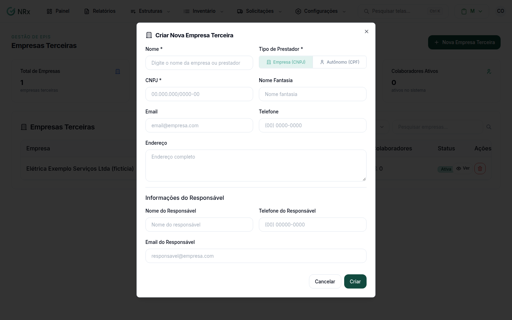
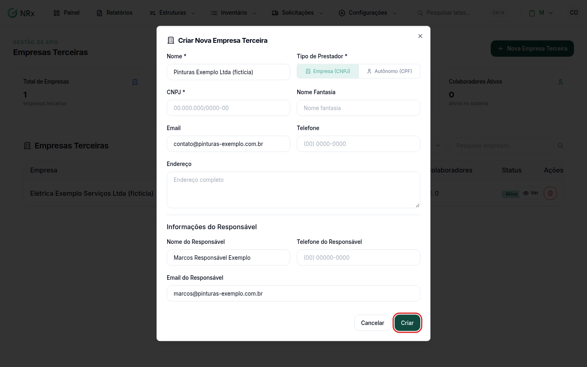

# Criar uma empresa terceira

**Para que serve:** cadastrar uma empresa ou um autônomo que presta serviço para a sua empresa.


**Quem pode fazer:** Administrador, com a permissão de criar terceiros.


## Antes de começar

* Tenha o CNPJ (empresa, incluindo MEI) ou o CPF (autônomo).


O CNPJ e o CPF não podem ser alterados depois. Confira antes de criar.


## Passo a passo



### Clique em Nova Empresa Terceira

Clique em **Estruturas › Terceiros** e depois em **Nova Empresa Terceira**. Abre a janela **Criar Nova Empresa Terceira**.

<figure><figcaption>
Janela Criar Nova Empresa Terceira
</figcaption></figure>



### Escolha o tipo

Preencha o **Nome** e, em **Tipo de Prestador**, escolha **Empresa (CNPJ)** ou **Autônomo (CPF)**. Digite o **CNPJ** ou o **CPF**.



### Complete os dados

Se quiser, preencha **Nome Fantasia**, **Email**, **Telefone** e **Endereço**. Em **Informações do Responsável**, preencha **Nome do Responsável**, **Telefone do Responsável** e **Email do Responsável**.

<figure><figcaption>
Contato e responsável
</figcaption></figure>



### Crie

Clique em **Criar**. Aparece "Empresa terceira criada com sucesso.".



## Dúvidas comuns

Um MEI é Empresa ou Autônomo?

Empresa (CNPJ). Autônomo é só para pessoa física sem CNPJ.

Posso trocar o tipo depois?

Não. O tipo e o documento (CNPJ ou CPF) não mudam depois de criados.

