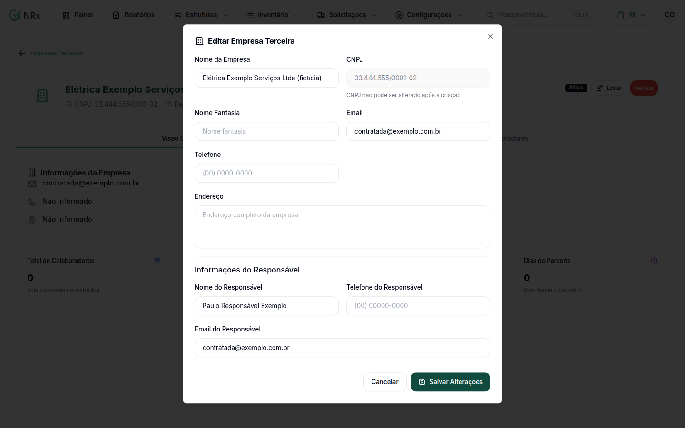

# Editar uma empresa terceira

**Para que serve:** corrigir nome, contato e responsável de uma empresa terceira.


**Quem pode fazer:** Gestor ou Administrador, com a permissão de editar terceiros.


## Antes de começar

* O CNPJ e o CPF não podem ser alterados.

## Passo a passo



### Abra a empresa

Clique em **Estruturas › Terceiros** e depois em **Ver** na empresa. No topo, clique em **Editar**. Abre **Editar Empresa Terceira**.

<figure><figcaption>
Janela Editar Empresa Terceira
</figcaption></figure>



### Corrija e salve

Altere o que precisar e clique em **Salvar Alterações**. Aparece "Empresa terceira atualizada com sucesso.".



## Deu errado?

| Mensagem na tela | O que fazer |
| --- | --- |
| "Nome é obrigatório" | Preencha o nome. |
| "Email deve ter formato válido" ou "Email do responsável deve ter formato válido" | Confira o e-mail (ex.: email@empresa.com). |
| "Nome deve ter no máximo 255 caracteres" | Encurte o nome. O mesmo vale para nome fantasia e nome do responsável. |
| "Telefone deve ter no máximo 20 caracteres" | Confira o telefone. O mesmo vale para o telefone do responsável. |
| "Endereço deve ter no máximo 500 caracteres" | Encurte o endereço. |

## Dúvidas comuns

Por que não consigo mudar o CNPJ?

O CNPJ e o CPF ficam bloqueados depois de criados.

Posso editar uma empresa inativa?

Não. O botão **Editar** só aparece em empresa ativa. Veja [Inativar ou reativar](inativar-terceiro.md).

