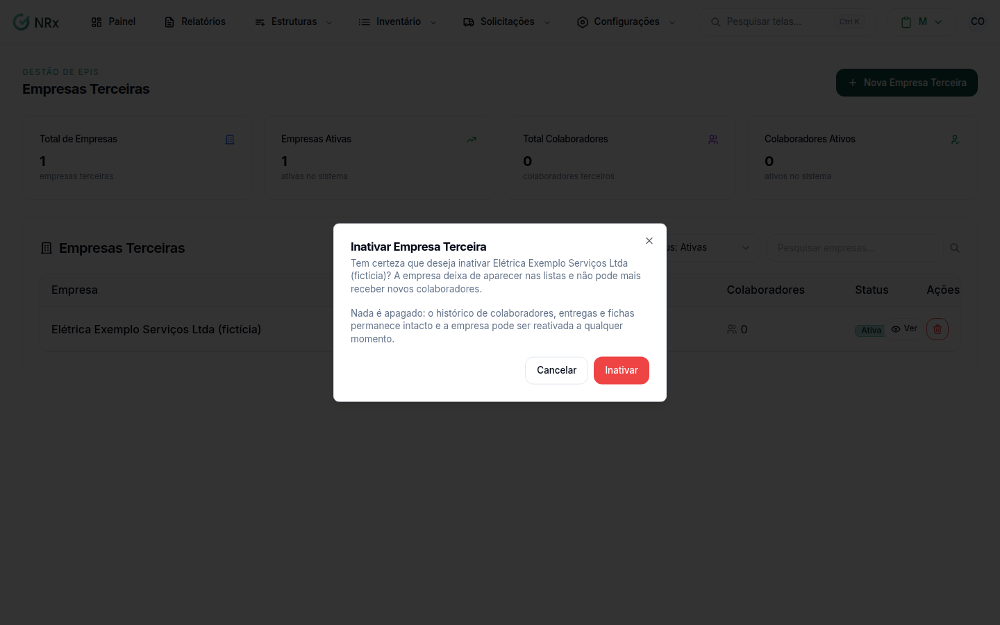

# Inativar ou reativar uma empresa terceira

**Para que serve:** encerrar ou retomar a prestação de serviço de uma empresa terceira. Nada é apagado.


**Quem pode fazer:** Administrador, com a permissão de inativar terceiros.


## Antes de começar

* Decida se os colaboradores da empresa também saem.

## Passo a passo



### Abra a inativação

Clique em **Estruturas › Terceiros**. Na linha da empresa, clique no ícone **Inativar empresa** (ou, dentro da empresa, no botão de inativar). Abre **Inativar Empresa Terceira**.

<figure><figcaption>
Inativar Empresa Terceira
</figcaption></figure>



### Decida sobre os colaboradores

Se a empresa tem colaboradores ativos, marque **Inativar também os colaboradores vinculados a esta empresa**, se quiser. Isso equivale a um desligamento, sem motivo de afastamento.



### Confirme

Clique em **Inativar**. Aparece "Empresa terceira inativada com sucesso!". A empresa deixa de aparecer nas listas e não recebe novos colaboradores.



### Para reativar

Filtre pelas inativas e clique em **Reativar empresa**. Na janela **Reativar Empresa Terceira**, clique em **Reativar**. Aparece "Empresa terceira reativada com sucesso!".




Reativar a empresa **não** reativa os colaboradores, nem os que foram inativados junto com ela. Reative um por um os que voltarem.


## Dúvidas comuns

Perco o histórico ao inativar?

Não. O histórico de colaboradores, entregas e fichas continua guardado.

Posso cadastrar colaborador numa empresa inativa?

Não. Aparece "Esta empresa está inativa e não pode receber novos colaboradores.".

