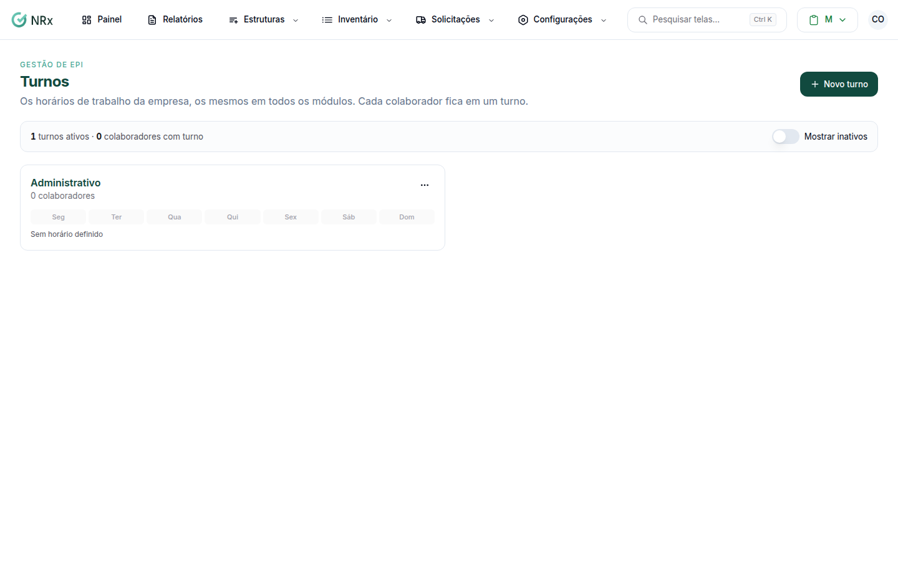

# Turnos

**Para que serve:** cadastrar os horários de trabalho da empresa. O mesmo turno vale para EPI, Treinamento, Documentos e CIPA. Cada colaborador fica em um turno.


No módulo Gestão de EPIs, clique em **Configurações › Turnos**.


<figure><figcaption>
Tela Turnos
</figcaption></figure>

## Comece por aqui

<table data-view="cards"><thead><tr><th></th><th></th><th data-hidden data-card-target data-type="content-ref"></th></tr></thead><tbody><tr><td><strong>Criar um turno</strong></td><td>Cadastre nome e horários.</td><td><a href="criar-turno.md">criar-turno.md</a></td></tr></tbody></table>

## Tarefas do dia a dia

<table data-view="cards"><thead><tr><th></th><th></th><th data-hidden data-card-target data-type="content-ref"></th></tr></thead><tbody><tr><td><strong>Editar um turno</strong></td><td>Mude nome ou horários.</td><td><a href="editar-turno.md">editar-turno.md</a></td></tr><tr><td><strong>Unir turnos</strong></td><td>Junte turnos repetidos com nomes diferentes.</td><td><a href="unir-turnos.md">unir-turnos.md</a></td></tr><tr><td><strong>Inativar ou reativar um turno</strong></td><td>Tire da lista um turno sem uso.</td><td><a href="inativar-turno.md">inativar-turno.md</a></td></tr></tbody></table>
