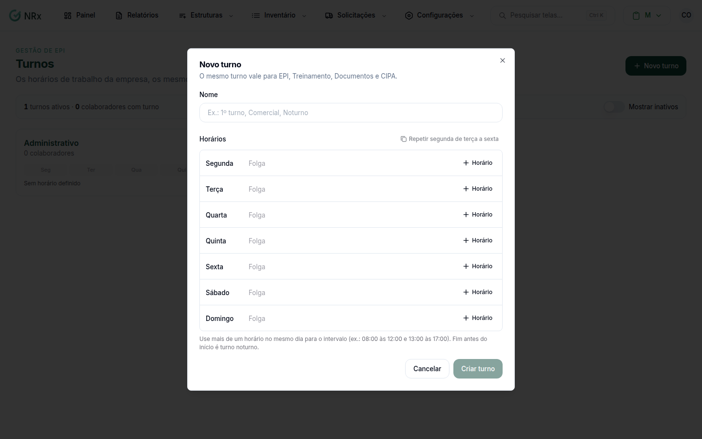

# Criar um turno

**Para que serve:** cadastrar um horário de trabalho para usar no cadastro dos colaboradores.


**Quem pode fazer:** Administrador, com a permissão de cadastrar turnos.


## Antes de começar

* Tenha os horários de cada dia da semana.

## Passo a passo



### Clique em Novo turno

Clique em **Configurações › Turnos** e depois em **Novo turno**.

<figure><figcaption>
Janela Novo turno
</figcaption></figure>



### Dê um nome

Em **Nome**, digite o nome do turno (ex.: 1º turno, Comercial, Noturno).



### Preencha os horários

Em **Horários**, informe o início e o fim de cada dia. Para copiar a segunda-feira para os outros dias úteis, clique em **Repetir segunda de terça a sexta**. Dia sem trabalho fica como **Folga**.



### Salve

Clique em **Criar turno**. Aparece "Turno criado.".



## Dúvidas comuns

Dá para criar um turno pelo cadastro do colaborador?

Dá. No campo **Turno** do colaborador, digite um nome novo: ele vira um turno.

O turno vale em outros módulos?

Sim. O mesmo turno vale para EPI, Treinamento, Documentos e CIPA.

