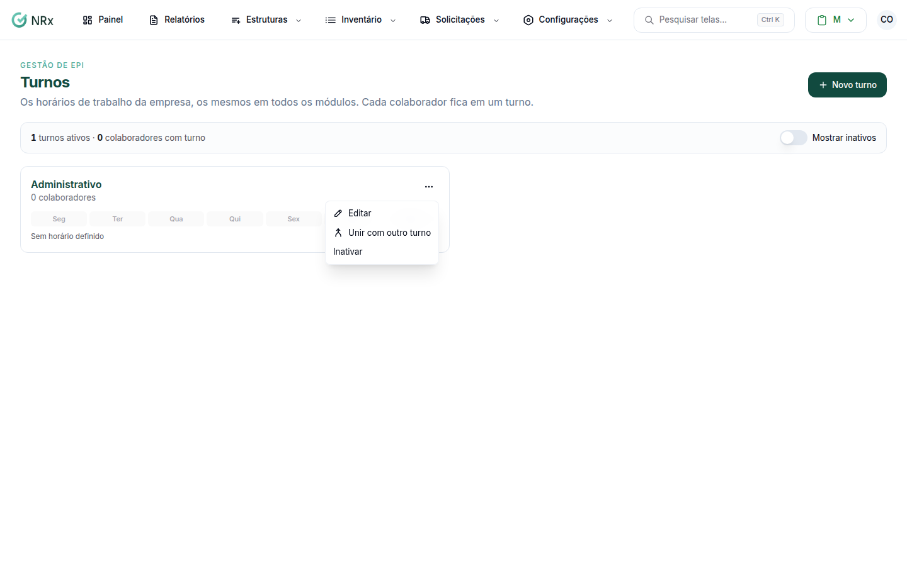

# Editar um turno

**Para que serve:** mudar o nome ou os horários de um turno.


**Quem pode fazer:** Gestor ou Administrador, com a permissão de editar turnos.


## Antes de começar

* O turno precisa estar ativo.

## Passo a passo



### Abra o turno

Clique em **Configurações › Turnos**. No cartão do turno, abra o menu e clique em **Editar**. Abre **Editar turno**.

<figure><figcaption>
Menu do turno
</figcaption></figure>



### Altere e salve

Mude o **Nome** ou os **Horários** e clique em **Salvar**. Aparece "Turno atualizado para todos os colaboradores dele.".



## Dúvidas comuns

A mudança vale para quem já está no turno?

Sim. O turno é atualizado para todos os colaboradores dele.

Tenho dois turnos iguais com nomes diferentes.

Junte os dois. Veja [Unir turnos](unir-turnos.md).

