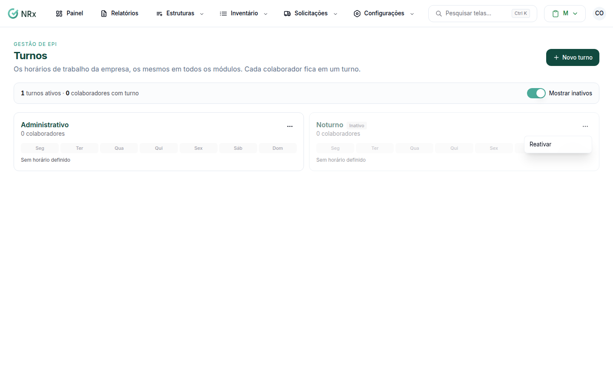

# Inativar ou reativar um turno

**Para que serve:** tirar da lista um turno que ninguém usa, ou trazer de volta um turno inativo.


**Quem pode fazer:** Administrador, com a permissão de inativar turnos.


## Antes de começar

* O turno não pode ter colaboradores. Se tiver, [una com outro turno](unir-turnos.md) antes.

## Passo a passo



### Inative

Clique em **Configurações › Turnos**. No cartão do turno, abra o menu e clique em **Inativar**. Aparece "Turno inativado.".



### Para reativar

Ligue **Mostrar inativos**. No cartão do turno, abra o menu e clique em **Reativar**. Aparece "Turno reativado.".

<figure><figcaption>
Reativar um turno
</figcaption></figure>



## Dúvidas comuns

A opção aparece como "Inativar (una antes)".

O turno ainda tem colaboradores. [Una com outro turno](unir-turnos.md) e depois inative.

Onde estão os turnos inativos?

Ligue **Mostrar inativos** no topo da tela.

