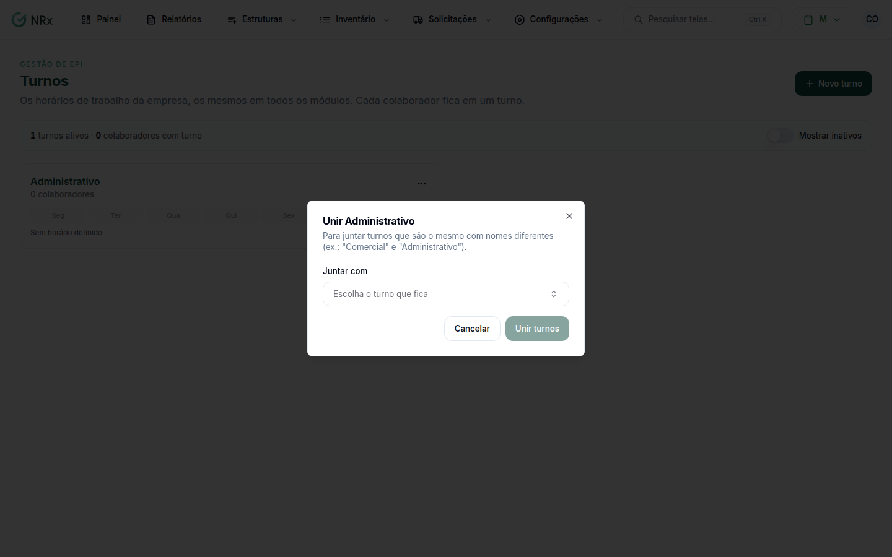

# Unir turnos

**Para que serve:** juntar turnos que são o mesmo com nomes diferentes (ex.: "Comercial" e "Administrativo").


**Quem pode fazer:** Gestor ou Administrador, com a permissão de editar turnos.


## Antes de começar

* Decida qual turno fica. O outro deixa de existir.

## Passo a passo



### Abra a união

Clique em **Configurações › Turnos**. No cartão do turno que vai sair, abra o menu e clique em **Unir com outro turno**.



### Escolha o turno que fica

Em **Juntar com**, escolha o turno que fica. Leia o aviso:

* os colaboradores passam para o turno que fica, com os horários dele;
* as janelas de votação da CIPA também mudam;
* quem digitar o nome antigo depois cai no turno que fica.

<figure><figcaption>
Janela Unir
</figcaption></figure>



### Confirme

Clique em **Unir turnos**.




Não dá para desfazer a união.


## Dúvidas comuns

Os horários do turno que sai são mantidos?

Não. Os colaboradores passam a seguir os horários do turno que fica.

Posso unir um turno inativo?

Não. A opção só aparece em turnos ativos.

