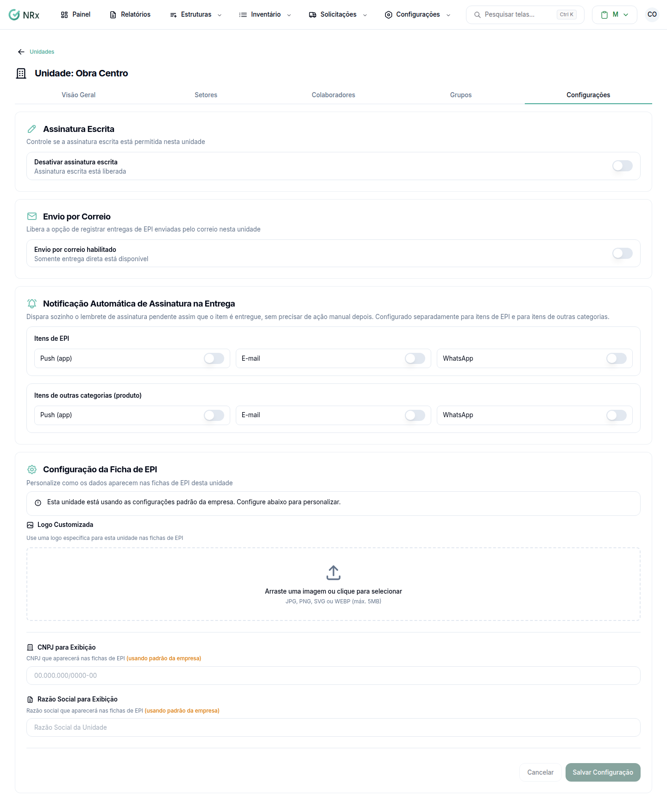

# Configurar a unidade no EPI

**Para que serve:** definir, por unidade, como as entregas são assinadas e como sai a ficha de EPI.


**Quem pode fazer:** quem abre a unidade no módulo Gestão de EPIs.


## Antes de começar

* Para a ficha, tenha o logo (JPG, PNG, SVG ou WEBP, até 5MB), o CNPJ e a razão social da unidade.

## Passo a passo



### Abra as configurações

Clique em **Estruturas › Unidades**. Na coluna **Ações**, clique no ícone de olho. Abra a aba **Configurações**.

<figure><figcaption>
Aba Configurações
</figcaption></figure>



### Ajuste as entregas

* **Assinatura Escrita:** use **Desativar assinatura escrita** para aceitar só reconhecimento facial.
* **Envio por Correio:** ligado, a opção aparece na tela de entrega e o admin decide item a item.
* **Notificação Automática de Assinatura na Entrega:** escolha **Push (app)** para **Itens de EPI** e **Itens de outras categorias (produto)**.

Cada mudança mostra a mensagem de configuração atualizada.



### Configure a ficha de EPI

Em **Configuração da Ficha de EPI**, envie a **Logo Customizada** e preencha **CNPJ para Exibição** e **Razão Social para Exibição**. Clique em **Salvar Configuração**. Aparece "Configuração atualizada com sucesso!".



## Deu errado?

| Mensagem na tela | O que fazer |
| --- | --- |
| "Formato inválido. Use JPG, PNG, SVG ou WEBP." | Troque o formato da imagem. |
| "Arquivo muito grande. Tamanho máximo: 5MB" | Use uma imagem menor. |
| "CNPJ deve conter 14 dígitos" | Confira o CNPJ. |

## Dúvidas comuns

A ficha da unidade fica diferente das outras?

Sim. Ao gerar a ficha, a unidade aparece como "(customizado)".

Saí sem salvar.

O aviso "Você tem alterações não salvas." lembra antes. Configure de novo e clique em **Salvar Configuração**.

