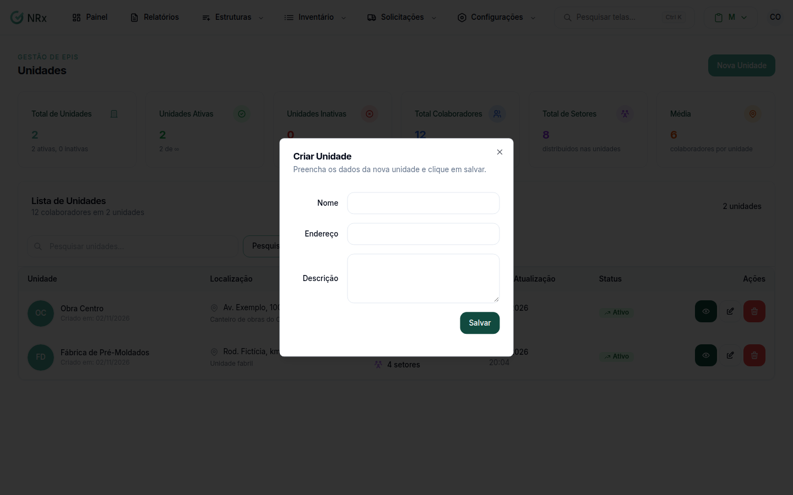

# Criar uma unidade

**Para que serve:** cadastrar um novo local de trabalho da empresa.


**Quem pode fazer:** Administrador, com a permissão de criar unidades.


## Antes de começar

* Tenha o nome e o endereço da unidade.

## Passo a passo



### Clique em Nova Unidade

Clique em **Estruturas › Unidades** e depois em **Nova Unidade**. Abre a janela **Criar Unidade**.

<figure><figcaption>
Janela Criar Unidade
</figcaption></figure>



### Preencha e salve

* **Nome:** obrigatório, até 128 caracteres.
* **Endereço:** obrigatório, até 255 caracteres.
* **Descrição:** opcional, até 255 caracteres.

Clique em **Salvar**. A unidade aparece na lista.



## Deu errado?

| Mensagem na tela | O que fazer |
| --- | --- |
| "Nome é obrigatório" ou "Endereço é obrigatório" | Preencha o campo. |
| "Nome muito longo", "Endereço muito longo" ou "Descrição muito longa" | Encurte o texto. |
| "Limite de unidades atingido" | O plano chegou ao limite de unidades. Fale com o seu contato comercial da GNRx. |
| "A criação de novas unidades está bloqueada para esta empresa." | Fale com o suporte GNRx. |

## Dúvidas comuns

E depois de criar?

Vincule a unidade aos [usuários](../usuarios/vincular-unidades.md) que trabalham nela. Eles só veem os registros das unidades vinculadas.

Vale para todos os módulos?

Sim. A unidade é a mesma em todos os módulos do GNRx.

