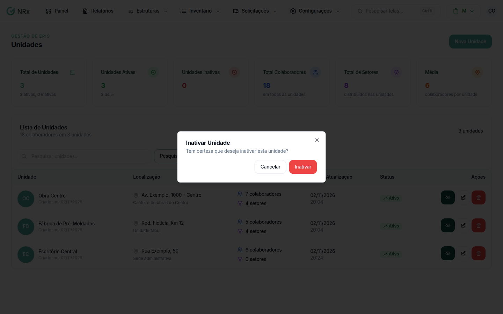

# Inativar uma unidade

**Para que serve:** tirar da lista uma unidade que a empresa não usa mais.


**Quem pode fazer:** Administrador, com a permissão de inativar unidades.


## Antes de começar

* Confira se a unidade é mesmo a certa. Use a [busca](listar-unidades.md).
* Veja quais usuários têm só essa unidade. Depois de inativar, eles perdem o vínculo com ela.

## O que acontece ao inativar

* **Usuários:** quem tinha essa unidade perde o vínculo com ela. Quem só tinha essa unidade passa a **não ver nada** até o administrador [vincular outra unidade](../usuarios/vincular-unidades.md).
* **Colaboradores e setores:** continuam vinculados à unidade.
* **GHEs da unidade** (Gestão de EPIs): são inativados junto.

## Passo a passo


Atenção: depois de inativar, não dá para reativar pelo sistema. Se inativou por engano, abra um [chamado no Suporte](../../suporte/abrir-chamado.md).




### Clique na lixeira

Clique em **Estruturas › Unidades**. Na coluna **Ações**, clique no ícone de lixeira. Abre **Inativar Unidade**: "Tem certeza que deseja inativar esta unidade?".

<figure><figcaption>
Inativar Unidade
</figcaption></figure>



### Confirme

Clique em **Inativar**. A unidade passa a aparecer como **Inativo**.



## Dúvidas comuns

A mensagem diz "excluída". A unidade foi apagada?

Não. A unidade fica inativa e continua na lista com o status **Inativo**.

Algo impede a inativação?

Não. A unidade pode ser inativada mesmo com colaboradores, setores e usuários vinculados.

Posso editar uma unidade inativa?

Não. Os ícones de lápis e de lixeira ficam apagados.

