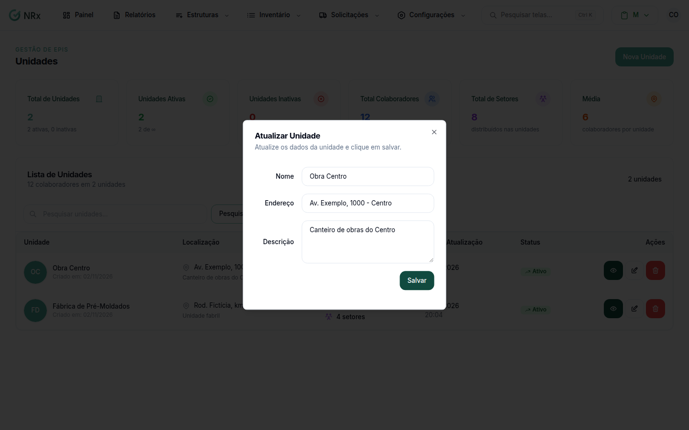

# Editar uma unidade

**Para que serve:** corrigir o nome, o endereço ou a descrição de uma unidade.


**Quem pode fazer:** Gestor ou Administrador, com a permissão de editar unidades.


## Antes de começar

* A unidade precisa estar ativa. Unidade inativa não pode ser editada.

## Passo a passo



### Abra a edição

Clique em **Estruturas › Unidades**. Na coluna **Ações**, clique no ícone de lápis. Abre a janela **Atualizar Unidade**.

<figure><figcaption>
Janela Atualizar Unidade
</figcaption></figure>



### Corrija e salve

Altere o que precisar e clique em **Salvar**. Aparece a mensagem de sucesso.



## Dúvidas comuns

O ícone de lápis está apagado. Por quê?

A unidade está inativa. Unidades inativas não podem ser editadas.

A mudança vale nos outros módulos?

Sim. A unidade é a mesma em todos os módulos.

