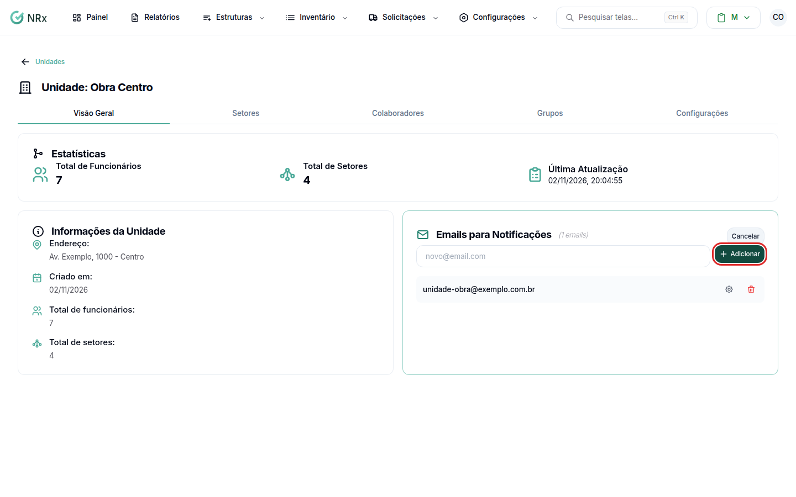
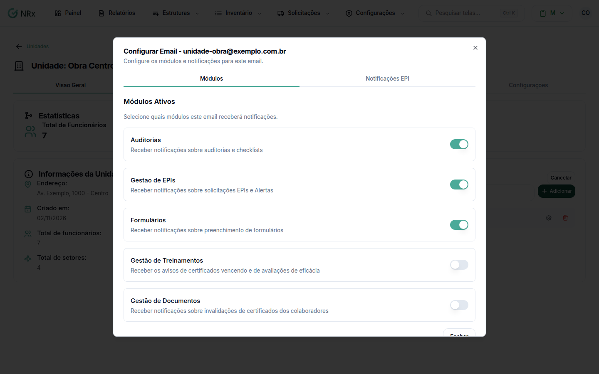

# Cadastrar os e-mails da unidade

**Para que serve:** definir quem recebe os avisos de cada unidade, como estoque mínimo, compras e validade.


**Quem pode fazer:** qualquer usuário com o módulo Gestão de EPIs.


Os E-mails SESMT recebem os avisos gerais de SST da empresa; os e-mails da unidade recebem a operação do EPI daquela unidade; acidentes e treinamentos chegam aos dois. Os dois ficam no mesmo cadastro: SESMT é o e-mail sem unidade.

## Antes de começar

* Tenha a lista de e-mails da unidade.

## Passo a passo



### Abra a unidade

Clique em **Estruturas › Unidades**. Na coluna **Ações**, clique no ícone de olho. Na aba **Visão Geral**, vá aos e-mails da unidade.



### Adicione o e-mail

Digite o e-mail (ex.: novo@email.com) e clique em **Adicionar**. Aparece "Email adicionado com sucesso".

<figure><figcaption>
E-mails da unidade
</figcaption></figure>



### Escolha o que ele recebe

Clique no e-mail. Na aba **Módulos**, ligue os **Módulos Ativos**. Na aba **Notificações EPI**, escolha **Alertas de Estoque Mínimo**, **Solicitações de Compra** e **Validade do Fabricante**. Em **Notificações por Setor**, ligue por setor **Devoluções** e **Solicitações de EPI**. Clique em **Salvar Notificações EPI**.

<figure><figcaption>
Módulos e notificações do e-mail
</figcaption></figure>



## Quem recebe cada aviso

| Aviso | E-mails SESMT | E-mails da unidade |
| --- | --- | --- |
| Acidentes e ocorrências | ✓ (todas as unidades) | ✓ (respeita os setores marcados) |
| Vencimento de treinamento, dúvidas do EAD, avaliação de eficácia | ✓ | ✓ |
| Avisos da CIPA (estabilidade, denúncias, SIPAT, contratadas) | ✓ | — |
| CA inválido | ✓ | — |
| Validade informada pelo fabricante | ✓ só quando o estoque não é de uma unidade | ✓ quando o estoque é da unidade |
| Devoluções, solicitação de compra, transferências (origem e destino), assinatura no fluxo de aprovação | — | ✓ conforme as notificações marcadas no e-mail e os setores |
| Documentos (só com "notificar gestores da unidade" ligado) | Documento da empresa ou da contratada: vai para todos | Documento de unidade: só a unidade. Documento de colaborador: só as unidades dele |

## Deu errado?


**"Email inválido"**: confira o e-mail digitado.


## Dúvidas comuns

Como tiro um e-mail?

Clique em **Remover email** e confirme em **Remover**. Aparece "Email removido com sucesso".

Qual a diferença para os E-mails SESMT?

Veja a tabela [Quem recebe cada aviso](#quem-recebe-cada-aviso). Os [E-mails SESMT](../../minha-empresa/emails-sesmt.md) ficam em **Minha Empresa › E-mails**.

