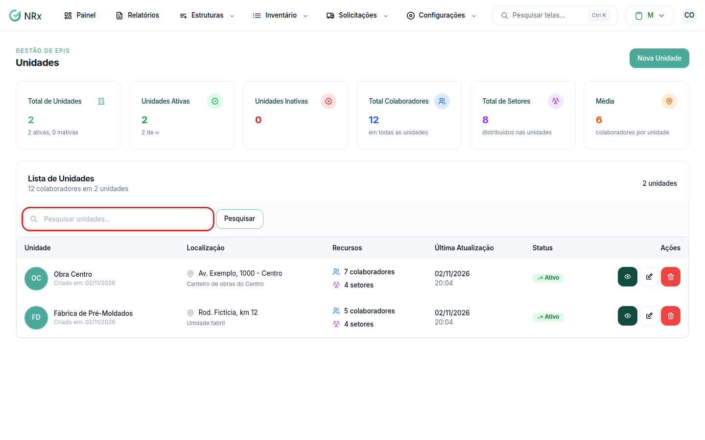

# Encontrar uma unidade

**Para que serve:** achar uma unidade na lista e abrir os detalhes dela.


**Quem pode fazer:** todas as roles (Operador, Supervisor, Gestor e Administrador), com a permissão de ver unidades.


## Antes de começar

* Nada a preparar.

## Passo a passo



### Abra a lista

Clique em **Estruturas › Unidades**. Abre a **Lista de Unidades**.

<figure><figcaption>
Lista de Unidades
</figcaption></figure>



### Pesquise ou filtre

Digite em **Pesquisar unidades...** e clique em **Pesquisar**. Para ver só as ativas ou só as inativas, use **Filtrar por status**. Para voltar à lista completa, clique em **Limpar**.



### Abra a unidade

Na coluna **Ações**, clique no ícone de olho.



## Dúvidas comuns

Como acho as unidades inativas?

Em **Filtrar por status**, escolha **Inativo**.

Apareceu "Nenhum resultado encontrado". E agora?

Confira o termo pesquisado ou o filtro de status. Clique em **Limpar** e tente de novo.

