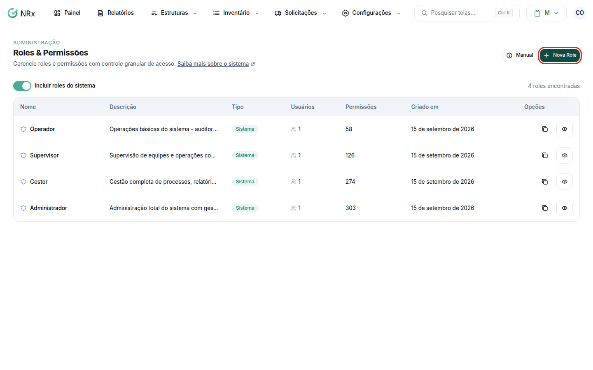
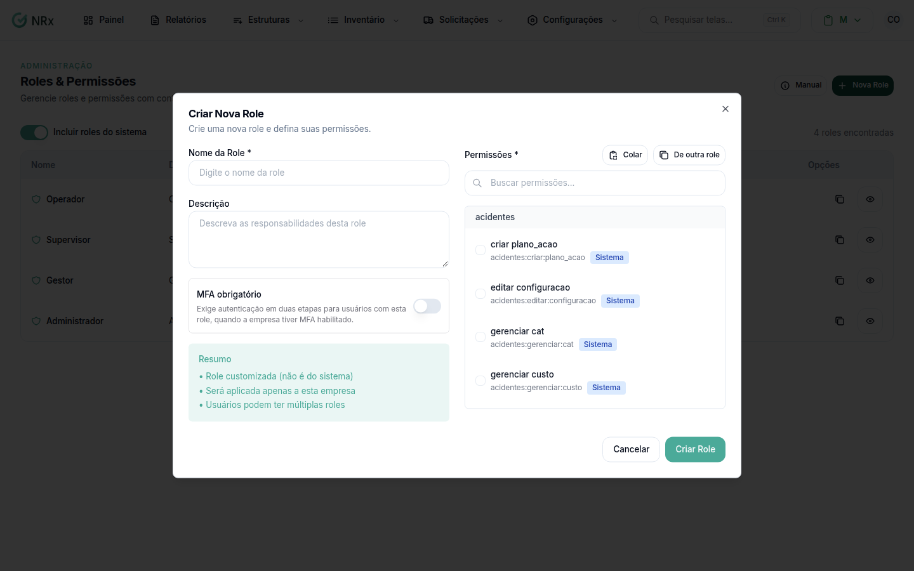
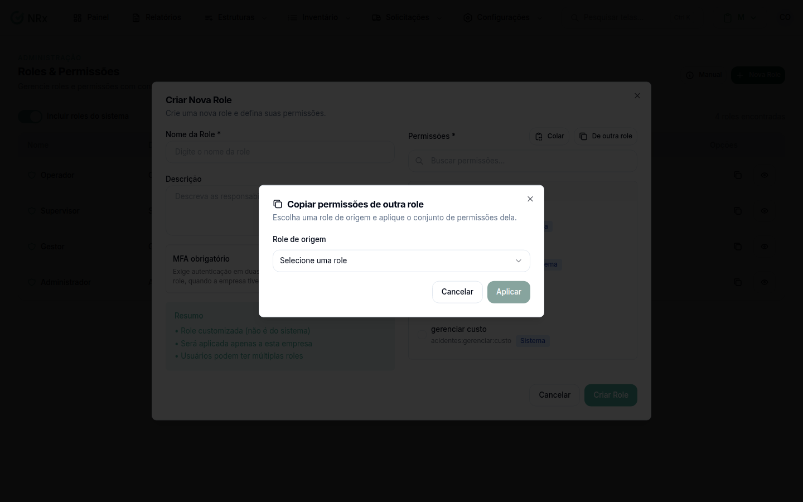
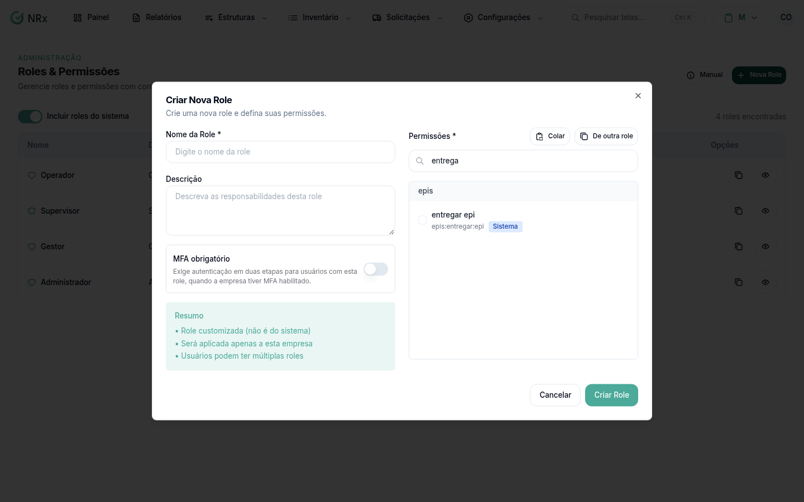

# Criar uma role

**Para que serve:** montar uma role com as permissões que a sua empresa precisa, quando nenhuma das padrão serve.


**Quem pode fazer:** Administrador, com a permissão de criar roles.


## Antes de começar

* Veja se uma role padrão já serve: [Entender as roles](o-que-sao-roles.md).
* O jeito mais rápido é partir de uma role pronta e ajustar.

## Passo a passo



### Abra as roles

Dentro de qualquer módulo, clique em **Configurações › Roles & Permissões**. Clique em **Nova Role**. Abre a janela **Criar Nova Role**.

<figure><figcaption>
Botão Nova Role
</figcaption></figure>



### Dê nome e descrição

Preencha o nome e a descrição. Se quiser exigir o código no login de quem tiver essa role, ligue **MFA obrigatório**.

<figure><figcaption>
Nome, descrição e MFA obrigatório
</figcaption></figure>



### Copie as permissões de outra role

Clique em **De outra role**, escolha a role e marque **Adicionar às atuais**. Clique em **Aplicar**.

<figure><figcaption>
Copiar de outra role
</figcaption></figure>



### Ajuste e salve

Use **Buscar permissões...** para achar o que quer ligar ou desligar. Confira o **Resumo** e clique em **Criar Role**. Aparece **Role criada com sucesso!**.

<figure><figcaption>
Permissões e Resumo
</figcaption></figure>



Depois, [atribua a role](atribuir-role.md) aos usuários.

## Dúvidas comuns

Qual a diferença entre Substituir tudo e Adicionar às atuais?

**Substituir tudo** apaga o que você já marcou e usa só as permissões da outra role. **Adicionar às atuais** soma as duas.

Para que serve o Colar?

Na lista de roles, clique no ícone **Copiar permissões** da role. Depois, na **Nova Role** ou no detalhe de outra role, clique em **Colar**. Funciona também entre abas do navegador e entre empresas.

Como excluo uma role?

Só as roles com o selo **Customizada** podem ser excluídas. O sistema pergunta: "Tem certeza que deseja excluir esta role? Esta ação não pode ser desfeita.".

