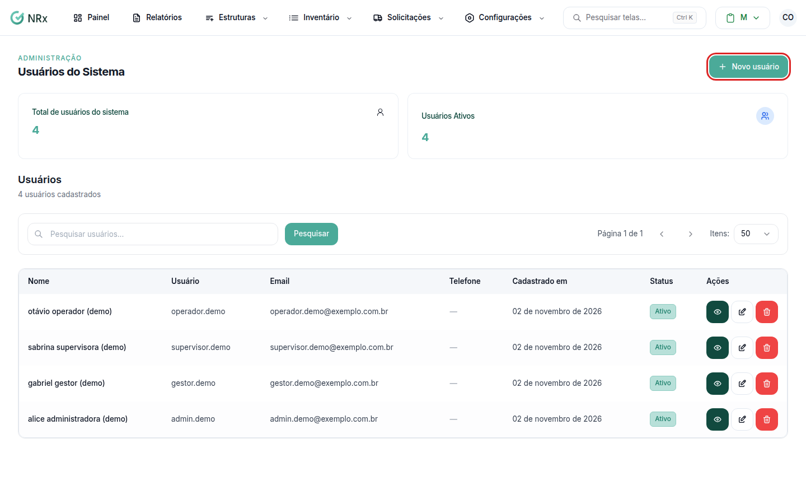
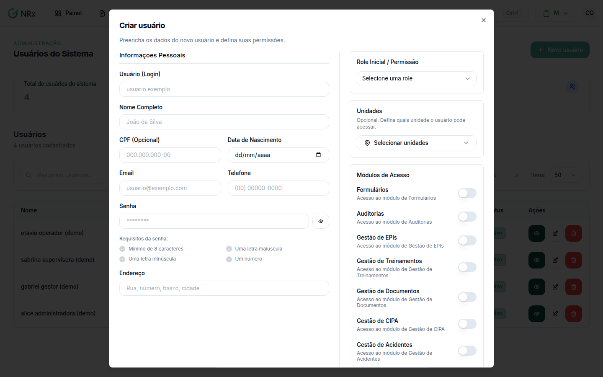
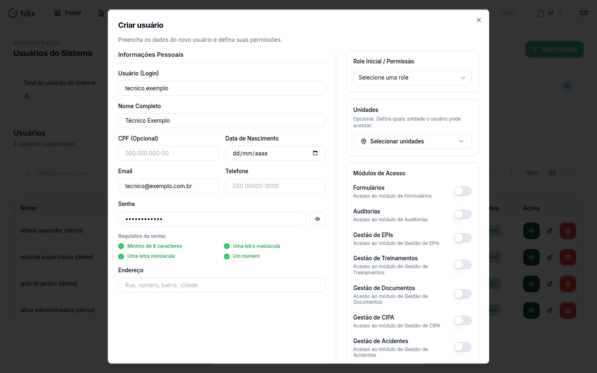
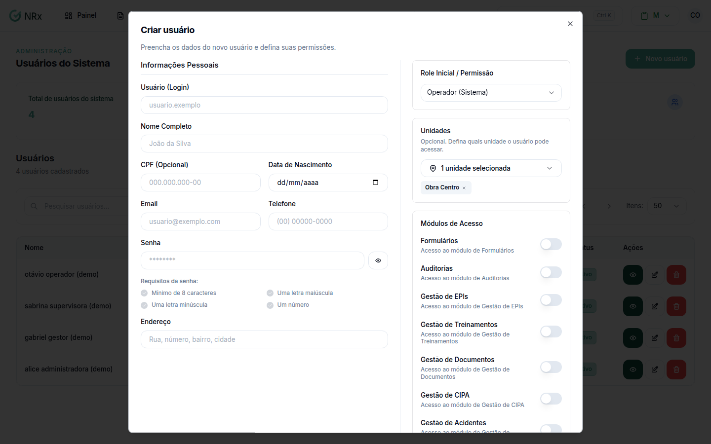
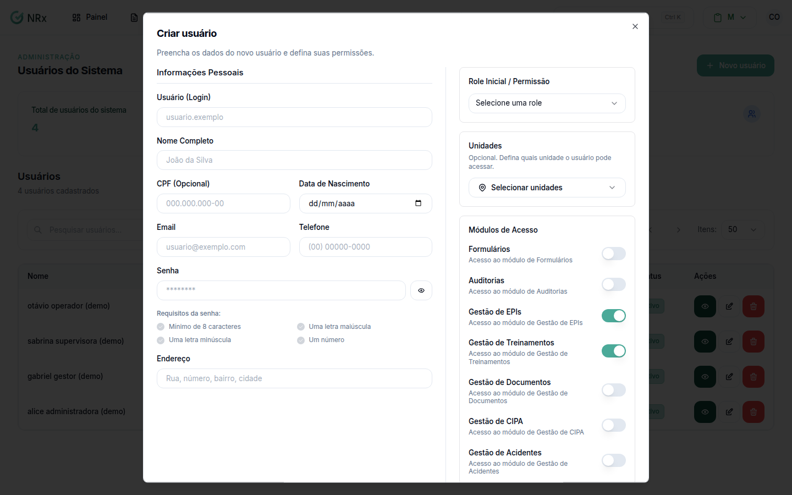

# Criar um usuário

**Para que serve:** dar acesso ao GNRx a uma pessoa nova.


**Quem pode fazer:** Administrador, com a permissão de criar usuários.


## Antes de começar

* Cadastre a [unidade](../unidades/README.md) onde a pessoa trabalha.
* Escolha a role da pessoa. Se tiver dúvida, veja [Entender as roles](o-que-sao-roles.md).

## Passo a passo



### Abra a tela de usuários

Dentro de qualquer módulo, clique em **Estruturas › Usuários**. Abre a tela **Usuários do Sistema**.

<figure><figcaption>
Tela Usuários do Sistema
</figcaption></figure>



### Clique em Novo usuário

Clique em **Novo usuário**. Abre a janela **Criar usuário**.

<figure><figcaption>
Janela Criar usuário
</figcaption></figure>



### Preencha as informações pessoais

* **Usuário (Login):** de 3 a 255 caracteres. Use só letras, números, ponto e sublinhado.
* **Nome Completo:** de 3 a 100 caracteres.
* **CPF (Opcional)**, **Data de Nascimento**, **Email**, **Telefone** e **Endereço**.
* **Senha:** no mínimo 8 caracteres, com letra maiúscula, letra minúscula e número.


Aqui a senha não precisa de caractere especial. Só a [recuperação por e-mail](../../acesso/esqueci-minha-senha.md) exige.


<figure><figcaption>
Informações pessoais preenchidas
</figcaption></figure>



### Escolha a role e as unidades

Em **Role Inicial / Permissão**, escolha a role. Ela é obrigatória.

Em **Unidades**, marque onde a pessoa trabalha.


Marque sempre pelo menos uma unidade. Sem unidade, a pessoa não vê os registros na maioria das telas.


<figure><figcaption>
Role e unidades
</figcaption></figure>



### Ligue os módulos e salve

Em **Módulos de Acesso**, ligue os módulos que a pessoa vai usar: Formulários, Auditorias, Gestão de EPIs, Gestão de Treinamentos, Gestão de Documentos, Gestão de CIPA ou Gestão de Acidentes.

Salve. Aparece **Usuário criado com sucesso**.

<figure><figcaption>
Módulos de acesso
</figcaption></figure>



## Deu errado?


**"Esse nome de usuário já está em uso."**: o login é único em toda a GNRx, não só na sua empresa. Escolha outro.



**"Acesso Negado: Você não tem permissão para acessar esta página"**: você não pode ver usuários. Peça a um Administrador.


## Dúvidas comuns

Dois usuários podem ter o mesmo CPF ou e-mail?

Podem. Só o login não pode se repetir.

A pessoa pode entrar com o CPF?

Pode, se o CPF estiver no cadastro. Veja [Entrar no sistema](../../acesso/entrar-no-sistema.md).

Esqueci de marcar a unidade. E agora?

Você pode marcar depois. Veja [Vincular unidades a um usuário](vincular-unidades.md).

